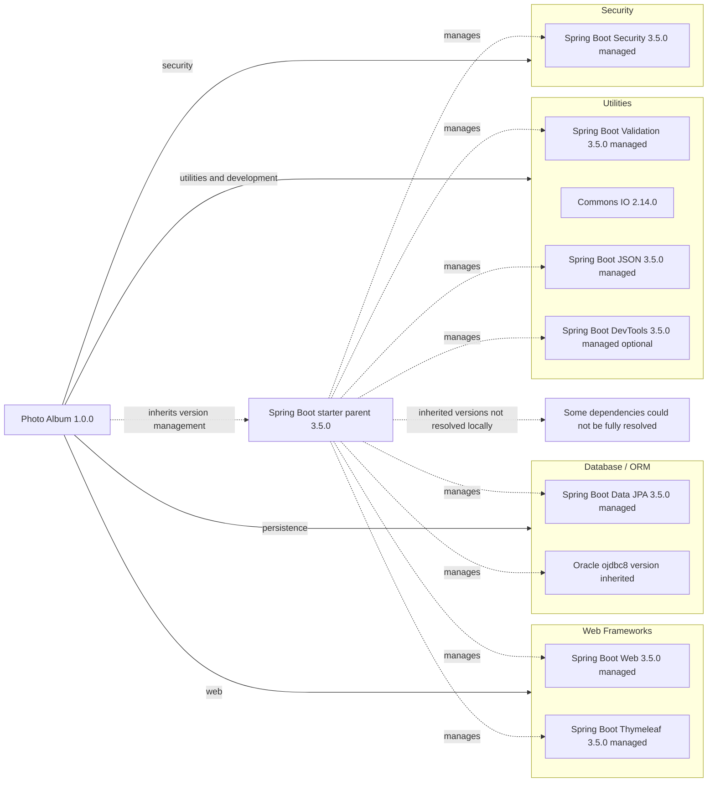

# Dependency Map

Photo Album (`com.photoalbum:photo-album:1.0.0`) declares 11 external dependencies in `pom.xml`: 9 application/development dependencies and 2 test dependencies. This map covers declared packages only; the parent POM and build plugin are not included in dependency counts.

## Dependencies

### Dependency Summary

| Category | Count | Key Libraries | Notes |
|----------|-------|---------------|-------|
| Web Frameworks | 2 | Spring Boot Web, Thymeleaf | Versions inherited from Spring Boot parent 3.5.0; compile scope |
| Database / ORM | 2 | Spring Boot Data JPA, Oracle ojdbc8 | JPA is compile scope; Oracle driver is runtime scope |
| Security | 1 | Spring Boot Security | Compile scope; version inherited from parent |
| Utilities | 4 | Spring Boot Validation, Commons IO 2.14.0, Spring Boot JSON, Spring Boot DevTools | Compile scope; DevTools is optional |
| **Total** | **9** | | Excludes 2 test dependencies |

Declared coordinates and scopes (`compile` is Maven's default when omitted):

| Category | Dependency | Version declaration / management | Scope |
|----------|------------|----------------------------------|-------|
| Web Frameworks | `org.springframework.boot:spring-boot-starter-web` | Omitted; parent-managed Spring Boot 3.5.0 | compile |
| Web Frameworks | `org.springframework.boot:spring-boot-starter-thymeleaf` | Omitted; parent-managed Spring Boot 3.5.0 | compile |
| Database / ORM | `org.springframework.boot:spring-boot-starter-data-jpa` | Omitted; parent-managed Spring Boot 3.5.0 | compile |
| Database / ORM | `com.oracle.database.jdbc:ojdbc8` | Omitted; inherited managed version not resolved | runtime |
| Security | `org.springframework.boot:spring-boot-starter-security` | Omitted; parent-managed Spring Boot 3.5.0 | compile |
| Utilities | `org.springframework.boot:spring-boot-starter-validation` | Omitted; parent-managed Spring Boot 3.5.0 | compile |
| Utilities | `commons-io:commons-io` | Explicit `2.14.0` | compile |
| Utilities | `org.springframework.boot:spring-boot-starter-json` | Omitted; parent-managed Spring Boot 3.5.0 | compile |
| Utilities | `org.springframework.boot:spring-boot-devtools` | Omitted; parent-managed Spring Boot 3.5.0 | compile; optional |

### Version & Compatibility Risks

The project targets Java 21 and uses Spring Boot parent 3.5.0. This initial 3.5 release and the older Commons IO 2.14.0 pin warrant review against current maintenance releases and advisories; no vulnerability or support-status verification was performed. Oracle driver compatibility with Java 21 and the deployed database must be checked once its inherited version is resolved; the `ojdbc8` artifact name alone does not establish incompatibility. Framework upgrades must preserve compatibility with the Jakarta-based Spring Boot 3 stack.

### Notable Observations

- The only declared parent is `org.springframework.boot:spring-boot-starter-parent:3.5.0` (`pom.xml:8–13`). No explicit BOM imports or dependency-management overrides are declared; Commons IO alone has an explicit dependency version.
- No dependency lockfile or local BOM was found. Consequently, inherited Oracle/H2 versions and resolved transitive dependencies are not enumerated; logging, ORM implementation, and JSON implementation libraries are not separately counted.
- The JSON starter is a JSON serialization dependency, despite its “Image processing” POM comment. It ordinarily overlaps with the Web starter's transitive JSON support; that transitive relationship was not resolved locally.
- DevTools is optional but has default compile scope, not runtime scope. The build also declares `org.springframework.boot:spring-boot-maven-plugin` without an explicit version; it is a build plugin, not an application dependency.

## Test Dependencies

| Framework | Version | Notes |
|-----------|---------|-------|
| `org.springframework.boot:spring-boot-starter-test` | Omitted; parent-managed Spring Boot 3.5.0 | Test starter; individual framework/support-library versions are not declared locally |
| `com.h2database:h2` | Omitted; inherited managed version not resolved | Test-scoped in-memory database |

Total test-scope dependencies: 2

No separate integration-testing or contract-testing dependency is declared. H2 differs from the production Oracle driver and cannot by itself establish Oracle-specific behavior compatibility; no tests were run or test sources inspected.
