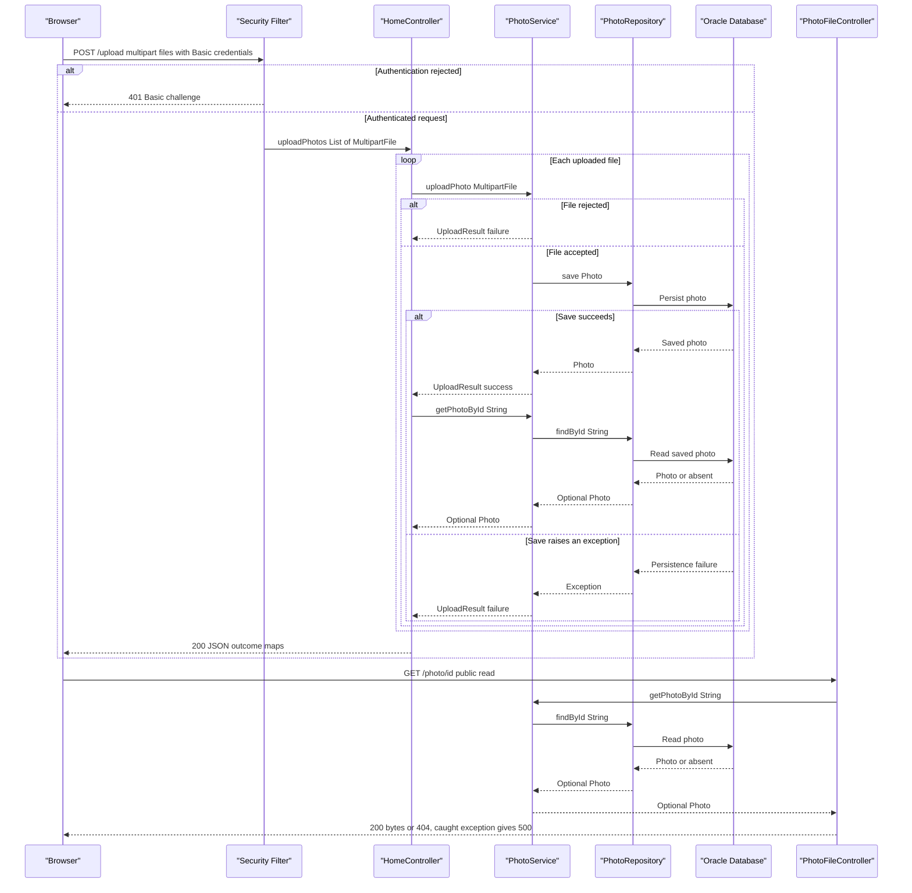

# API & Service Communication Contracts

Five explicit application endpoints expose gallery HTML, multipart uploads, photo bytes, and deletion. Browser requests, controller-to-service calls, and database access are synchronous request/response operations; no messaging-based contracts were found.

## Service Catalog

| Service | Port | Category | Purpose |
|---|---|---|---|
| `photoalbum-java-app` / Maven `com.photoalbum:photo-album` | 8080, published as 8080 | Business; serves the API/UI directly | Single source-built application providing all photo operations. Dependencies include Spring Boot Web, Thymeleaf, Data JPA, Security, Validation, JSON, and the Oracle JDBC driver. |
| `oracle-db` | 1521; also publishes 5500 | Infrastructure | Third-party Oracle XE container; persistence dependency, not an application HTTP API. |

Evidence: [build identity and dependencies](../../../../../../pom.xml#L8-L101), [Compose service definitions and published ports](../../../../../../docker-compose.yml#L1-L46), [application port](../../../../../../src/main/resources/application.properties#L1-L2). The build defines one JAR and no Maven modules; the supplied deployment is Docker Compose, with no additional service deployment descriptors discovered.

## API Endpoints Inventory

Status codes below describe controller behavior; authentication failures are intercepted before controller execution.

| Service | Method | Path | Request Type | Response Type |
|---|---|---|---|---|
| Application / `HomeController` | GET | `/` | No body or required query parameters | 200 HTML `index` view using `List<Photo>`; retrieval exceptions render an empty gallery instead of an error status. [Source](../../../../../../src/main/java/com/photoalbum/controller/HomeController.java#L38-L51) |
| Application / `HomeController` | POST | `/upload` | `multipart/form-data`, repeated `files` parts bound to `List<MultipartFile>`; HTTP Basic required | 200 JSON `Map<String,Object>` with aggregate success and per-file outcomes; 400 JSON for an empty list or a handled `MultipartException`. [Source](../../../../../../src/main/java/com/photoalbum/controller/HomeController.java#L56-L107) |
| Application / `DetailController` | GET | `/detail/{id}` | String path parameter `id` | 200 HTML `detail` view with `Photo` and navigation IDs; redirect to `/` for blank/missing photo or caught exception (normally 302). [Source](../../../../../../src/main/java/com/photoalbum/controller/DetailController.java#L18-L58) |
| Application / `DetailController` | POST | `/detail/{id}/delete` | String path parameter `id`; no body contract; HTTP Basic required | Redirect to `/` (normally 302), with success/error flash attributes for deletion, absence, or caught failure. [Source](../../../../../../src/main/java/com/photoalbum/controller/DetailController.java#L64-L79) |
| Application / `PhotoFileController` | GET | `/photo/{id}` | String path parameter `id` | 200 `ResponseEntity<Resource>` containing image bytes and stored MIME type; 404 for blank ID, absent photo, or absent bytes; 500 on caught exception. [Source](../../../../../../src/main/java/com/photoalbum/controller/PhotoFileController.java#L23-L86) |

No URL/header/query-based API versioning is implemented in these mappings. Photo responses set `Cache-Control: no-cache, no-store, must-revalidate, private`, `Pragma`, `Expires`, and `X-Photo-ID`, `X-Photo-Name`, `X-Photo-Size` headers ([source](../../../../../../src/main/java/com/photoalbum/controller/PhotoFileController.java#L74-L83)). The browser adds an optional `_t` cache-busting query parameter; the controller does not bind it ([client](../../../../../../src/main/resources/static/js/upload.js#L176-L179)).

Upload contract details:

- The normal JSON envelope contains `success`, `uploadedPhotos`, and `failedUploads`; `success` means at least one uploaded-photo response entry exists. Individual rejection or save failure still returns 200, even if every file fails. Error-only 400 envelopes contain `success: false` and `error`. These are map-based transport contracts, not serialized `UploadResult` instances ([controller](../../../../../../src/main/java/com/photoalbum/controller/HomeController.java#L58-L107)).
- Configured multipart limits are 10 MB per file and 50 MB per request. Service validation failures become per-file error outcomes, rather than a blanket 400. Detailed validation rules belong in `business-workflows.md`; configuration details belong in `configuration-inventory.md` ([multipart limits](../../../../../../src/main/resources/application.properties#L23-L25), [service outcomes](../../../../../../src/main/java/com/photoalbum/service/impl/PhotoServiceImpl.java#L81-L184)).
- A successful save triggers a lookup before constructing its response entry. An absent lookup contributes no entry; an exception in that lookup is not caught by the upload handler, so its successful-envelope behavior is not guaranteed ([controller](../../../../../../src/main/java/com/photoalbum/controller/HomeController.java#L69-L97)).

## Management & Observability Endpoints

| Service | Endpoint | Custom Metrics (if any) |
|---|---|---|
| Application | No explicit health, Actuator, Swagger UI, or metrics routes found | No custom metric registrations or metric annotations found |
| Oracle container | No application management HTTP route defined by this repository; port 5500 is published | None defined by application source |

The [dependency list](../../../../../../pom.xml#L30-L101) has no Actuator, Springdoc, or Prometheus exporter, and the three controllers above contain all explicit request mappings. Application logging is present, but is not a metrics API. Oracle's Compose health check is a database command, not an HTTP endpoint ([Compose](../../../../../../docker-compose.yml#L11-L24)).

## DTOs & Contracts

- **No gateway-level DTOs:** there is no gateway or cross-service response aggregation.
- **`Photo`:** mutable service-owned domain entity used as a server-rendered view model and as the source for selected upload response values and photo bytes; not accepted as a JSON request body or directly returned as the upload JSON entity. Entity details belong in `data-architecture.md` ([class and setters](../../../../../../src/main/java/com/photoalbum/model/Photo.java#L19-L156), [upload projection](../../../../../../src/main/java/com/photoalbum/controller/HomeController.java#L73-L83)).
- **`UploadResult`:** mutable internal service result carrying per-file upload outcome; converted into map entries by the controller rather than exposed directly ([class](../../../../../../src/main/java/com/photoalbum/model/UploadResult.java#L6-L48), [conversion](../../../../../../src/main/java/com/photoalbum/controller/HomeController.java#L69-L90)).
- **Framework contracts:** `MultipartFile` is the upload request carrier; `Map<String,Object>` and lists of maps form the JSON response; `Resource`/`ByteArrayResource` carries binary downloads. No immutable record DTOs were found in the application.
- **Serialization:** Spring MVC JSON conversion is supplied by the Web/JSON starters; no custom Jackson mapper, serializer, or serialization annotations were found. HTML uses Thymeleaf views. No OpenAPI/Swagger, protobuf, or GraphQL schemas were discovered ([dependencies](../../../../../../pom.xml#L30-L79), [response construction](../../../../../../src/main/java/com/photoalbum/controller/HomeController.java#L56-L107), [binary response](../../../../../../src/main/java/com/photoalbum/controller/PhotoFileController.java#L68-L83)).

## Communication Patterns

- **Synchronous:** browser → controllers → injected `PhotoService` → `PhotoRepository` → database using JPA/JDBC. These are local method calls within one application, not inter-service HTTP calls ([controller injection](../../../../../../src/main/java/com/photoalbum/controller/HomeController.java#L29-L42), [service/repository calls](../../../../../../src/main/java/com/photoalbum/service/impl/PhotoServiceImpl.java#L49-L74), [repository](../../../../../../src/main/java/com/photoalbum/repository/PhotoRepository.java#L15-L29)).
- **Browser asynchronous execution, not messaging:** JavaScript awaits `fetch('/upload')` and parses JSON. This is ordinary HTTP request/response, with no broker, pub/sub, or background-job contract. The client shows errors on failure and does not retry ([client](../../../../../../src/main/resources/static/js/upload.js#L90-L133)). Templates also load Bootstrap assets over HTTPS from jsDelivr; these are browser-to-CDN requests, not backend service calls ([template](../../../../../../src/main/resources/templates/index.html#L7), [script](../../../../../../src/main/resources/templates/index.html#L124)).
- **Resilience:** no application circuit breaker, retry policy, bulkhead, fallback service, or explicit request/JDBC timeout was found. Local exception handling yields empty gallery HTML, detail redirects, binary 500s, or per-file upload errors as listed above. Compose's database health-check timeout and container restart policy are operational controls, not API retry policies ([Compose](../../../../../../docker-compose.yml#L19-L24), [restart](../../../../../../docker-compose.yml#L46)).
- **Discovery/routing:** no registry, gateway, aggregation/composition layer, or client-side load balancer. Compose supplies the fixed database hostname `oracle-db`; local execution defaults to localhost ([Compose connection](../../../../../../docker-compose.yml#L32-L36), [local connection](../../../../../../src/main/resources/application.properties#L9-L15)).
- **Availability:** Compose starts the application after the database is healthy. Database failure thereafter can degrade gallery/detail responses or fail upload/image operations; there is no alternate downstream service. See `configuration-inventory.md` for deployment/startup mechanisms ([dependency](../../../../../../docker-compose.yml#L41-L43)).
- **API security:** stateless HTTP Basic authenticates POST `/upload` and `/detail/*/delete`; unauthenticated/invalid-credential access is normally challenged with 401. All other requests are permitted. An in-memory user has an ADMIN role, but these routes require only authentication, not an ADMIN role check. CSRF is explicitly disabled. No JWT/OAuth2 or application HTTPS/TLS configuration was found; Compose publishes the application HTTP port directly, so externally terminated TLS cannot be inferred ([security configuration](../../../../../../src/main/java/com/photoalbum/config/SecurityConfig.java#L28-L59), [published port](../../../../../../docker-compose.yml#L39-L40)).

## Service Technology Matrix

| Service | Web | Data Access | Discovery | Gateway | Actuator | Cache | Metrics |
|---|---|---|---|---|---|---|---|
| `photoalbum-java-app` | Spring MVC / Thymeleaf / JSON | Spring Data JPA, Oracle JDBC | None; fixed DB hostname | None | None found | No application cache found; binary HTTP caching prohibited | Logging only; no exporter found |
| `oracle-db` | No application HTTP API; 5500 published | Oracle XE server | Compose hostname | None | Not applicable | Not assessed; database internals outside API scope | None defined by repository |

Evidence: [framework dependencies](../../../../../../pom.xml#L30-L101), [database service](../../../../../../docker-compose.yml#L1-L24), [photo response caching policy](../../../../../../src/main/java/com/photoalbum/controller/PhotoFileController.java#L74-L83). Detailed persistence/caching analysis belongs in `data-architecture.md`.

## Service Communication Sequence

Primary upload flow, including authentication, per-file failures, and subsequent binary retrieval. Solid arrows indicate synchronous requests/calls; dashed arrows indicate responses, not broker messages. Error handling is local, with no retry or circuit-breaker fallback.

Sources: [upload flow and response](../../../../../../src/main/java/com/photoalbum/controller/HomeController.java#L56-L107), [upload service](../../../../../../src/main/java/com/photoalbum/service/impl/PhotoServiceImpl.java#L81-L184), [photo retrieval](../../../../../../src/main/java/com/photoalbum/controller/PhotoFileController.java#L37-L86), [authentication](../../../../../../src/main/java/com/photoalbum/config/SecurityConfig.java#L45-L59). Multipart parsing failures return 400 before the per-file loop; post-save lookup exceptions can escape the normal 200 path, as noted in the endpoint inventory.
