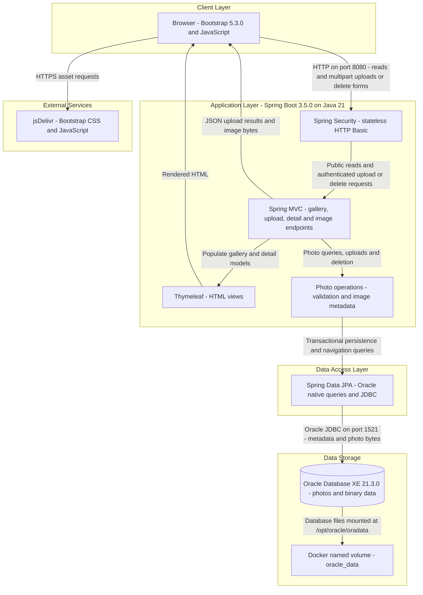
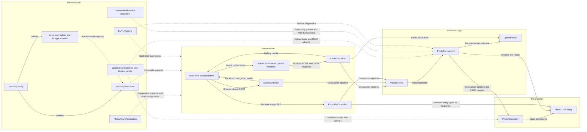

# Architecture Diagram

Photo Album is a single Spring Boot web application with a server-rendered gallery, asynchronous uploads, and database-backed photo delivery. The diagrams describe verified source and configuration, not a running deployment.

## Application Architecture

### Technology Stack Summary

| Layer | Technology | Version | Purpose |
|---|---|---|---|
| Runtime and packaging | Java; Spring Boot executable JAR | Java 21; Boot 3.5.0; application 1.0.0 | Single application process; versions and packaging declared in [pom.xml:8–26](../../../../../../pom.xml#L8-L26). |
| Presentation | Spring MVC; Thymeleaf | Managed by Boot 3.5.0; individual versions not pinned | HTTP endpoints and server-rendered views; [pom.xml:30–41](../../../../../../pom.xml#L30-L41). |
| Browser UI | Bootstrap; plain JavaScript Fetch API | Bootstrap 5.3.0; JavaScript version unspecified | CDN styling, drag-and-drop selection and asynchronous multipart uploads; [index.html:7–8,124–125](../../../../../../src/main/resources/templates/index.html#L124-L125), [upload.js:48–106](../../../../../../src/main/resources/static/js/upload.js#L48-L106). |
| Security | Spring Security; BCrypt; in-memory user store | Managed by Boot 3.5.0 | Environment-configured administrator and stateless HTTP Basic authentication; [SecurityConfig.java:28–59](../../../../../../src/main/java/com/photoalbum/config/SecurityConfig.java#L28-L59). |
| Business logic | Spring services, transactions and Java ImageIO | Boot-managed Spring; Java 21 | Upload validation, header-based dimension inspection, browsing and deletion; [PhotoServiceImpl.java:27–46,111–169](../../../../../../src/main/java/com/photoalbum/service/impl/PhotoServiceImpl.java#L111-L169). |
| Data access | Spring Data JPA; Oracle JDBC `ojdbc8` | Managed by Boot 3.5.0; individual versions not pinned | Entity CRUD and Oracle-specific native queries; [pom.xml:43–54](../../../../../../pom.xml#L43-L54), [PhotoRepository.java:15–62](../../../../../../src/main/java/com/photoalbum/repository/PhotoRepository.java#L15-L62). |
| Database | Oracle Database Express Edition | Compose image tag 21.3.0-xe | Photo metadata and binary storage; [docker-compose.yml:3–16](../../../../../../docker-compose.yml#L3-L16). |
| Container build and runtime | Maven; Eclipse Temurin JRE; Docker Compose | Maven 3.9.9; JRE 21; Compose version unspecified | Multi-stage JAR build and application/database topology; [Dockerfile:1–31](../../../../../../Dockerfile#L1-L31), [docker-compose.yml:26–53](../../../../../../docker-compose.yml#L26-L53). |
| Tests only | H2 in-memory database | Boot-managed; not pinned | Test datasource, not production storage; [pom.xml:88–93](../../../../../../pom.xml#L88-L93), [application-test.properties:1–9](../../../../../../src/test/resources/application-test.properties#L1-L9). |

### Data Storage & External Services

The `photos` entity stores UUID identifiers, filenames, MIME types, byte sizes, upload timestamps, dimensions and binary image bytes through a JPA `@Lob`; uploads save those bytes directly to the repository, and image responses read them back ([Photo.java:15–90](../../../../../../src/main/java/com/photoalbum/model/Photo.java#L15-L90), [PhotoServiceImpl.java:154–169](../../../../../../src/main/java/com/photoalbum/service/impl/PhotoServiceImpl.java#L154-L169), [PhotoFileController.java:53–83](../../../../../../src/main/java/com/photoalbum/controller/PhotoFileController.java#L53-L83)). The default datasource targets localhost Oracle XE; the Docker profile targets `oracle-db`, and Compose persists database files in `oracle_data` ([application.properties:9–21](../../../../../../src/main/resources/application.properties#L9-L21), [application-docker.properties:1–17](../../../../../../src/main/resources/application-docker.properties#L1-L17), [docker-compose.yml:14–16,32–43](../../../../../../docker-compose.yml#L32-L43)). Both main profiles configure `ddl-auto=create`, so persistent database files do not imply schema/data preservation across application startup. Browser pages fetch Bootstrap from jsDelivr; no cache, broker, object-storage client or server-side external API integration is identified in the inspected build and application source.

### Key Architectural Decisions

- **Layered monolith with constructor injection:** MVC controllers depend on the `PhotoService` interface; its transactional implementation delegates persistence to `PhotoRepository` ([HomeController.java:24–42](../../../../../../src/main/java/com/photoalbum/controller/HomeController.java#L24-L42), [PhotoServiceImpl.java:27–56](../../../../../../src/main/java/com/photoalbum/service/impl/PhotoServiceImpl.java#L27-L56)).
- **Database-backed images and Oracle coupling:** Binary content is stored with metadata rather than uploaded to a file/object store. Gallery/navigation queries use Oracle constructs including `NVL`, `ROWNUM`, `SYSDATE` and `DUAL` ([Photo.java:36–41](../../../../../../src/main/java/com/photoalbum/model/Photo.java#L36-L41), [PhotoRepository.java:23–62](../../../../../../src/main/java/com/photoalbum/repository/PhotoRepository.java#L23-L62)).
- **Public reading, authenticated mutations:** The security filter requires authentication for upload/delete POST routes, permits other requests, uses stateless HTTP Basic and disables CSRF. Administrator passwords are BCrypt-encoded in the in-memory user store ([SecurityConfig.java:28–59](../../../../../../src/main/java/com/photoalbum/config/SecurityConfig.java#L28-L59)).

## Component Relationships

### Component Inventory

| Component | Layer | Type | Responsibility |
|---|---|---|---|
| `index.html`, `detail.html` | Presentation | Thymeleaf views | Render gallery/detail metadata, image URLs and delete form; [index.html:81–113](../../../../../../src/main/resources/templates/index.html#L81-L113), [detail.html:50–94](../../../../../../src/main/resources/templates/detail.html#L50-L94). |
| `upload.js` | Presentation | Browser script | Select/validate files, send multipart upload and update gallery from JSON; [upload.js:48–158](../../../../../../src/main/resources/static/js/upload.js#L48-L158). |
| `HomeController` | Presentation | MVC controller | Serve `GET /`, process `POST /upload`, serialize upload outcomes and handle multipart errors; [HomeController.java:29–106](../../../../../../src/main/java/com/photoalbum/controller/HomeController.java#L29-L106). |
| `DetailController` | Presentation | MVC controller | Display `GET /detail/{id}`, look up adjacent photos, delete with `POST /detail/{id}/delete` and redirect; [DetailController.java:18–78](../../../../../../src/main/java/com/photoalbum/controller/DetailController.java#L18-L78). |
| `PhotoFileController` | Presentation | Binary-response controller | Serve `GET /photo/{id}` from stored bytes with MIME type and no-cache headers; [PhotoFileController.java:22–86](../../../../../../src/main/java/com/photoalbum/controller/PhotoFileController.java#L22-L86). |
| `PhotoService` | Business logic | Service interface | Define listing, lookup, upload, deletion and previous/next navigation contracts; [PhotoService.java:13–54](../../../../../../src/main/java/com/photoalbum/service/PhotoService.java#L13-L54). |
| `PhotoServiceImpl` | Business logic | Transactional Spring service | Validate MIME type/size, inspect dimensions with a 40-million-pixel ceiling, save bytes and coordinate repository operations; [PhotoServiceImpl.java:27–46](../../../../../../src/main/java/com/photoalbum/service/impl/PhotoServiceImpl.java#L27-L46), [81–169](../../../../../../src/main/java/com/photoalbum/service/impl/PhotoServiceImpl.java#L81-L169), [190–229](../../../../../../src/main/java/com/photoalbum/service/impl/PhotoServiceImpl.java#L190-L229). |
| `UploadResult` | Business logic | Result DTO | Carry success, filename, error and photo ID between service and upload controller; [UploadResult.java:6–10](../../../../../../src/main/java/com/photoalbum/model/UploadResult.java#L6-L10). |
| `PhotoRepository` | Data access | Spring Data repository | `JpaRepository<Photo, String>` CRUD plus native gallery/navigation queries; [PhotoRepository.java:15–62](../../../../../../src/main/java/com/photoalbum/repository/PhotoRepository.java#L15-L62). |
| `Photo` | Data access | JPA entity | Map `photos`, its upload-time index, UUID and binary/metadata columns; [Photo.java:15–90](../../../../../../src/main/java/com/photoalbum/model/Photo.java#L15-L90). |
| `PhotoAlbumApplication` | Infrastructure | Boot entry point | Start Spring Boot and enable application auto-configuration/component scanning; [PhotoAlbumApplication.java:9–14](../../../../../../src/main/java/com/photoalbum/PhotoAlbumApplication.java#L9-L14). |
| `SecurityConfig`, `SecurityFilterChain`, in-memory admin, BCrypt encoder | Infrastructure | Configuration and security beans | Define credentials, password encoding and request authentication policy; [SecurityConfig.java:25–59](../../../../../../src/main/java/com/photoalbum/config/SecurityConfig.java#L25-L59). |
| Application properties and Docker profile | Infrastructure | Externalized settings | Configure HTTP port, datasource/JPA behavior, upload limits and logging; [application.properties:1–34](../../../../../../src/main/resources/application.properties#L1-L34), [application-docker.properties:1–32](../../../../../../src/main/resources/application-docker.properties#L1-L32). |
| Transactional service boundary | Infrastructure | Spring transaction annotations | Apply service-wide transactions and explicit read-only query methods; [PhotoServiceImpl.java:27–28,52–70](../../../../../../src/main/java/com/photoalbum/service/impl/PhotoServiceImpl.java#L52-L70), [215–229](../../../../../../src/main/java/com/photoalbum/service/impl/PhotoServiceImpl.java#L215-L229). |
| SLF4J logging | Infrastructure | Cross-cutting diagnostics | Record controller/service outcomes and failures; [HomeController.java:27–46](../../../../../../src/main/java/com/photoalbum/controller/HomeController.java#L27-L46), [PhotoServiceImpl.java:164–180](../../../../../../src/main/java/com/photoalbum/service/impl/PhotoServiceImpl.java#L164-L180). |
