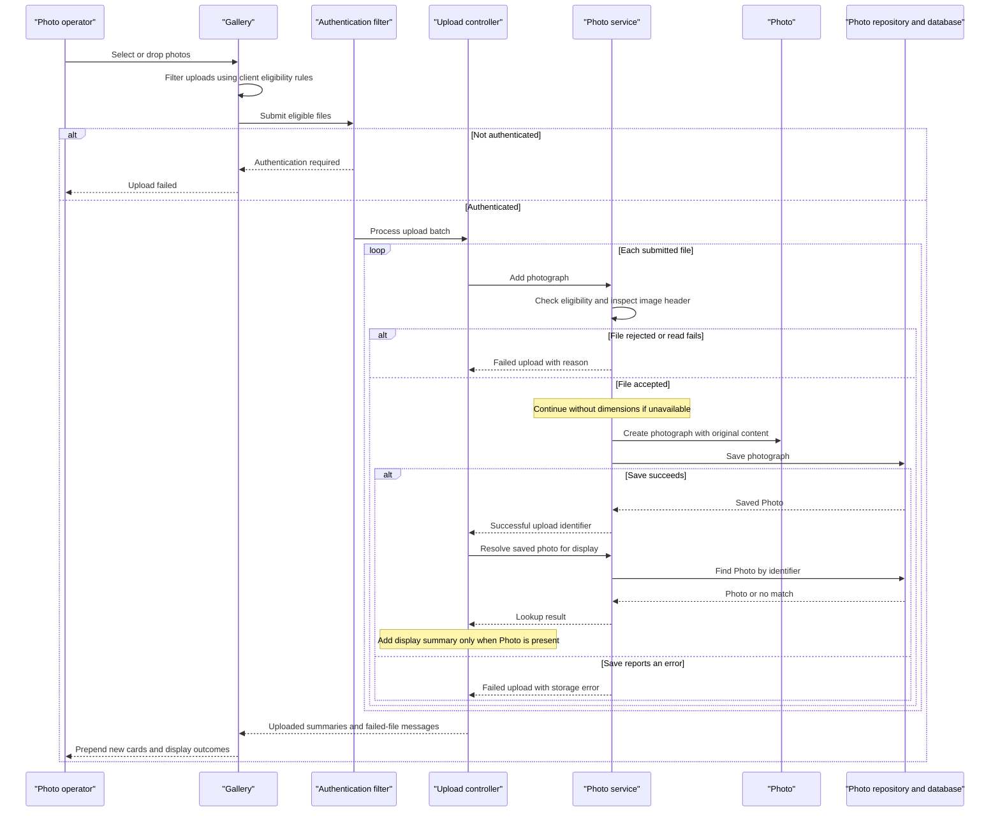

# Core Business Workflows

Photo Album lets visitors browse uploaded photos and move between full-size images. Authenticated operators can add multiple photos and permanently remove individual photos from the shared gallery.

## Domain Entities

| Entity | Service / Bounded Context | Description | Key Relationships |
|---|---|---|---|
| Photo | PhotoService / Photo collection management | A stored photograph with its original content and information used for display and chronological navigation. | Independent item in the shared collection; previous and next photos are derived from upload times, not explicit relationships. |
| UploadResult (operation outcome, not a persisted entity) | PhotoService / Photo ingestion | Communicates whether one upload succeeded or failed and why. | Identifies the created Photo on success; the controller combines outcomes into one batch response. |

Sources: [Photo.java:12–91](../../../../../../src/main/java/com/photoalbum/model/Photo.java#L12-L91), [UploadResult.java:3–10](../../../../../../src/main/java/com/photoalbum/model/UploadResult.java#L3-L10), [PhotoServiceImpl.java:212–229](../../../../../../src/main/java/com/photoalbum/service/impl/PhotoServiceImpl.java#L212-L229).

There is no separate album, user-owned collection, tagging, or sharing entity in the inspected model. The configured administrator is an authentication identity, not a photo-owner relationship ([SecurityConfig.java:33–42](../../../../../../src/main/java/com/photoalbum/config/SecurityConfig.java#L33-L42)).

## Service-to-Domain Mapping

This is one application with internal components, not independently deployed business services. The bounded contexts below are descriptive groupings, not explicit DDD modules.

| Service | Domain Context | Owned Entities | External Dependencies |
|---|---|---|---|
| PhotoServiceImpl | Photo ingestion, collection browsing, navigation, removal | Photo; produces UploadResult | PhotoRepository and the photo database; local image-header inspection |
| HomeController (entry-point adapter) | Gallery presentation and batch upload orchestration | None; composes Photo summaries and upload outcomes | Internal PhotoService |
| DetailController and PhotoFileController (entry-point adapters) | Full-size viewing, neighboring-photo navigation, deletion | None; consume Photo | Internal PhotoService |

PhotoService is the common application access path to collection data; PhotoRepository is its persistence boundary. Controllers do not maintain independent copies of business state. Sources: [PhotoServiceImpl.java:27–46](../../../../../../src/main/java/com/photoalbum/service/impl/PhotoServiceImpl.java#L27-L46), [PhotoRepository.java:15–29](../../../../../../src/main/java/com/photoalbum/repository/PhotoRepository.java#L15-L29), [HomeController.java:29–32](../../../../../../src/main/java/com/photoalbum/controller/HomeController.java#L29-L32), [DetailController.java:23–26](../../../../../../src/main/java/com/photoalbum/controller/DetailController.java#L23-L26), [PhotoFileController.java:28–31](../../../../../../src/main/java/com/photoalbum/controller/PhotoFileController.java#L28-L31).

## Primary Workflows

### Workflow 1: Upload a batch and immediately expand the gallery

1. The operator drops files or selects them in the gallery. Browser-side **Upload eligibility** filtering runs before submission; acceptable files are submitted together through `POST /upload`.
2. The security filter requires authentication before the upload controller runs. The controller applies **Batch presence**, then invokes PhotoService separately for each file.
3. PhotoService applies **Upload eligibility** and **Image dimensions** rules. It reads the content, attempts to extract dimensions, creates a Photo, and saves it through PhotoRepository.
4. The service returns a per-file UploadResult. For each successful result, the controller reads the Photo back by its identifier and builds a display summary; failures are collected separately.
5. The response combines uploaded summaries and failed-file messages using **Batch outcome**. The browser shows success and/or errors and prepends successful photos to the existing gallery without reloading the page.
6. Newly inserted cards request their image content separately. Rejected files do not become gallery entries; a failed individual result does not itself roll back previously successful uploads.

Sources: [upload.js:48–132](../../../../../../src/main/resources/static/js/upload.js#L48-L132), [upload.js:135–179](../../../../../../src/main/resources/static/js/upload.js#L135-L179), [SecurityConfig.java:45–59](../../../../../../src/main/java/com/photoalbum/config/SecurityConfig.java#L45-L59), [HomeController.java:56–97](../../../../../../src/main/java/com/photoalbum/controller/HomeController.java#L56-L97), [PhotoServiceImpl.java:80–184](../../../../../../src/main/java/com/photoalbum/service/impl/PhotoServiceImpl.java#L80-L184).

### Workflow 2: Browse the collection and navigate full-size photos

1. A visitor opens `GET /`. HomeController loads the collection through PhotoService and renders the gallery using **Chronological navigation** ordering. Retrieval errors are logged and render an empty collection rather than an error page.
2. Selecting a card opens `GET /detail/{id}`. DetailController finds the Photo and separately resolves older and newer neighbors through PhotoService.
3. The detail page combines the selected Photo with neighboring identifiers. Navigation controls appear only where a neighbor exists; there is no wraparound.
4. The browser requests `GET /photo/{id}` for the image itself. PhotoFileController fetches the same Photo and returns its stored bytes using **Image availability** behavior.
5. A blank or missing detail identifier, or an exception while assembling detail, redirects the visitor to the gallery. Missing image content instead produces an image-request failure, not a gallery redirect.

Sources: [HomeController.java:38–50](../../../../../../src/main/java/com/photoalbum/controller/HomeController.java#L38-L50), [DetailController.java:32–58](../../../../../../src/main/java/com/photoalbum/controller/DetailController.java#L32-L58), [PhotoServiceImpl.java:52–74](../../../../../../src/main/java/com/photoalbum/service/impl/PhotoServiceImpl.java#L52-L74), [PhotoServiceImpl.java:212–229](../../../../../../src/main/java/com/photoalbum/service/impl/PhotoServiceImpl.java#L212-L229), [detail.html:62–94](../../../../../../src/main/resources/templates/detail.html#L62-L94), [PhotoFileController.java:37–86](../../../../../../src/main/java/com/photoalbum/controller/PhotoFileController.java#L37-L86).

### Workflow 3: Confirm and remove a photo

1. The detail page presents a delete form with a browser confirmation prompt; cancellation prevents submission in that browser.
2. An authenticated operator submits `POST /detail/{id}/delete`. PhotoService first looks up the Photo.
3. If present, the service deletes the Photo record, including its stored content. If absent, it returns false rather than creating a deletion record.
4. DetailController sets a success, not-found, or generic failure flash message and redirects to the gallery. The refreshed collection no longer includes a successfully deleted Photo.

Sources: [detail.html:50–59](../../../../../../src/main/resources/templates/detail.html#L50-L59), [SecurityConfig.java:53–58](../../../../../../src/main/java/com/photoalbum/config/SecurityConfig.java#L53-L58), [DetailController.java:64–78](../../../../../../src/main/java/com/photoalbum/controller/DetailController.java#L64-L78), [PhotoServiceImpl.java:190–208](../../../../../../src/main/java/com/photoalbum/service/impl/PhotoServiceImpl.java#L190-L208), [index.html:37–46](../../../../../../src/main/resources/templates/index.html#L37-L46).

The inspected application source has no scheduled jobs, message listeners, or custom startup business-state initialization. Its main entry point simply starts the application ([PhotoAlbumApplication.java:9–14](../../../../../../src/main/java/com/photoalbum/PhotoAlbumApplication.java#L9-L14)).

## Cross-Service Data Flows

There is no gateway, remote business-service aggregation, event choreography, or circuit breaker in the inspected implementation. Composition occurs inside the single application:

- **Batch result composition:** HomeController receives each UploadResult, resolves successful Photo identifiers, and joins their display summaries into `uploadedPhotos` alongside `failedUploads`. A successful save whose follow-up lookup returns empty contributes to neither list; an exception in that lookup is not caught by the upload handler ([HomeController.java:69–97](../../../../../../src/main/java/com/photoalbum/controller/HomeController.java#L69-L97)).
- **Detail composition:** DetailController combines the selected Photo with two neighbor lookups and renders the result. The browser then independently retrieves the binary image by the same identifier ([DetailController.java:38–54](../../../../../../src/main/java/com/photoalbum/controller/DetailController.java#L38-L54), [detail.html:62–94](../../../../../../src/main/resources/templates/detail.html#L62-L94)).
- **Degradation:** Gallery retrieval failure yields an empty gallery; detail assembly failure redirects home; image-serving exceptions yield an error response. There is no alternate photo store or cached business-data fallback. Image responses explicitly discourage caching ([HomeController.java:40–49](../../../../../../src/main/java/com/photoalbum/controller/HomeController.java#L40-L49), [DetailController.java:55–57](../../../../../../src/main/java/com/photoalbum/controller/DetailController.java#L55-L57), [PhotoFileController.java:74–86](../../../../../../src/main/java/com/photoalbum/controller/PhotoFileController.java#L74-L86)).

## Business Workflow Sequence

Primary process: authenticated batch ingestion followed by immediate gallery display. Alternatives represent actual rejection and degraded metadata behavior, not an invented circuit breaker.

Sources: [SecurityConfig.java:45–59](../../../../../../src/main/java/com/photoalbum/config/SecurityConfig.java#L45-L59), [HomeController.java:56–97](../../../../../../src/main/java/com/photoalbum/controller/HomeController.java#L56-L97), [PhotoServiceImpl.java:80–184](../../../../../../src/main/java/com/photoalbum/service/impl/PhotoServiceImpl.java#L80-L184), [upload.js:60–158](../../../../../../src/main/resources/static/js/upload.js#L60-L158).

## Business Rules & Decision Logic

### Validation and decisions

- **Batch presence:** A null or empty file list produces a bad-request result with “No files provided.” MultipartException is also mapped to that message ([HomeController.java:63–67,100–106](../../../../../../src/main/java/com/photoalbum/controller/HomeController.java#L63-L106)).
- **Upload eligibility:** The service lowercases the submitted content type and checks the configured allowlist, rejects files larger than the configured maximum, then rejects empty files. Current defaults permit JPEG, PNG, GIF, and WebP and cap a file at 10,485,760 bytes; multipart limits are 10MB per file and 50MB per request. Browser filtering mirrors the type and size defaults but does not check emptiness. MIME acceptance is based on supplied metadata, not a requirement that every file decode successfully ([PhotoServiceImpl.java:85–109](../../../../../../src/main/java/com/photoalbum/service/impl/PhotoServiceImpl.java#L85-L109), [application.properties:23–30](../../../../../../src/main/resources/application.properties#L23-L30), [upload.js:65–79](../../../../../../src/main/resources/static/js/upload.js#L65-L79)).
- **Image dimensions:** If a reader can inspect the image header, width multiplied by height must not exceed 40,000,000 pixels. An IOException rejects the file; other dimension-extraction exceptions are logged and processing continues without requiring dimensions. An unavailable reader likewise does not reject the file ([PhotoServiceImpl.java:33–34](../../../../../../src/main/java/com/photoalbum/service/impl/PhotoServiceImpl.java#L33-L34), [PhotoServiceImpl.java:111–162](../../../../../../src/main/java/com/photoalbum/service/impl/PhotoServiceImpl.java#L111-L162)).
- **Declared Photo constraints:** Original filename must be nonblank and at most 255 characters; MIME type must be nonblank and at most 50 characters; size must be present and positive; upload time must be present. These are entity validation annotations, not explicit controller validation calls ([Photo.java:28–64](../../../../../../src/main/java/com/photoalbum/model/Photo.java#L28-L64)).
- **Batch outcome:** A processed batch returns an OK response even if all files fail; its `success` value is true only when at least one uploaded summary was collected. Failures are reported per file. A property declares a maximum of ten files per upload, but neither the inspected controller nor service enforces that count ([HomeController.java:69–97](../../../../../../src/main/java/com/photoalbum/controller/HomeController.java#L69-L97), [application.properties:30](../../../../../../src/main/resources/application.properties#L30)).
- **Chronological navigation:** The gallery sorts newest first. “Previous” chooses the first result strictly older than the current upload time, ordered newest first; “next” chooses the first strictly newer result ordered oldest first and excludes times later than the database current time. Equal timestamps do not become neighbors, and absent neighbors do not wrap ([PhotoRepository.java:23–62](../../../../../../src/main/java/com/photoalbum/repository/PhotoRepository.java#L23-L62), [PhotoServiceImpl.java:212–229](../../../../../../src/main/java/com/photoalbum/service/impl/PhotoServiceImpl.java#L212-L229)).
- **Image availability:** A blank identifier, missing Photo, or absent/empty stored bytes returns not found; other serving exceptions return a server error ([PhotoFileController.java:37–86](../../../../../../src/main/java/com/photoalbum/controller/PhotoFileController.java#L37-L86)).

### Lifecycle, computed values, and integrity

- Each new Photo receives a generated identity and the application’s current upload time. Its lifecycle is creation followed by retrieval or physical deletion; there are no approval, publication, or soft-delete states. Duplicate filename/content prevention and per-user ownership checks are not present in the upload/delete paths ([Photo.java:78–90](../../../../../../src/main/java/com/photoalbum/model/Photo.java#L78-L90), [PhotoServiceImpl.java:154–208](../../../../../../src/main/java/com/photoalbum/service/impl/PhotoServiceImpl.java#L154-L208)).
- Dimensions are derived from the image header. File sizes and timestamps are formatted for display; dimensions are omitted when unavailable. Metadata and content belong to the same Photo, so there is no separate file-store cleanup or bidirectional entity relationship to maintain ([PhotoServiceImpl.java:111–166](../../../../../../src/main/java/com/photoalbum/service/impl/PhotoServiceImpl.java#L111-L166), [detail.html:103–130](../../../../../../src/main/resources/templates/detail.html#L103-L130)).
- Collection continuity across restarts is not guaranteed by the supplied configuration: both default and Docker profiles specify schema creation at startup. This is configuration-driven behavior, not an explicit business initialization workflow ([application.properties:17–21](../../../../../../src/main/resources/application.properties#L17-L21), [application-docker.properties:13–17](../../../../../../src/main/resources/application-docker.properties#L13-L17)).

### Cross-cutting concerns

- **Transactions:** PhotoServiceImpl is transactional; retrieval and navigation methods explicitly use read-only transactions. The controller has no enclosing batch transaction, so each external upload service call has its own boundary. Save exceptions are caught inside the service, but a transaction/commit failure can still escape at the proxy boundary; the upload controller has no general catch or compensation for that case ([PhotoServiceImpl.java:27–29,52–74](../../../../../../src/main/java/com/photoalbum/service/impl/PhotoServiceImpl.java#L27-L74), [PhotoServiceImpl.java:164–184](../../../../../../src/main/java/com/photoalbum/service/impl/PhotoServiceImpl.java#L164-L184), [HomeController.java:69–97](../../../../../../src/main/java/com/photoalbum/controller/HomeController.java#L69-L97)).
- **Error handling:** Validation and most ingestion failures become UploadResult messages. Read/delete failures are wrapped in RuntimeException and translated by the relevant controller into the workflow outcomes above. There is no business exception hierarchy, retry queue, or compensating workflow in these paths ([PhotoServiceImpl.java:52–74](../../../../../../src/main/java/com/photoalbum/service/impl/PhotoServiceImpl.java#L52-L74), [PhotoServiceImpl.java:144–208](../../../../../../src/main/java/com/photoalbum/service/impl/PhotoServiceImpl.java#L144-L208)).
- **Audit/logging:** Upload acceptance, rejection, deletion, retrieval failures, and image delivery are logged. No persisted business audit history is implemented in these paths ([PhotoServiceImpl.java:85–181](../../../../../../src/main/java/com/photoalbum/service/impl/PhotoServiceImpl.java#L85-L181), [PhotoServiceImpl.java:190–208](../../../../../../src/main/java/com/photoalbum/service/impl/PhotoServiceImpl.java#L190-L208), [PhotoFileController.java:44–85](../../../../../../src/main/java/com/photoalbum/controller/PhotoFileController.java#L44-L85)).
- **Authorization:** Gallery, detail, and image reads are public. Upload and delete POST operations require HTTP Basic authentication; the configured account has ADMIN role, but the matchers require authentication rather than an explicit role or resource-ownership check. Security is stateless and CSRF protection is disabled. Browser deletion confirmation is only a usability guard, not authorization ([SecurityConfig.java:33–59](../../../../../../src/main/java/com/photoalbum/config/SecurityConfig.java#L33-L59), [detail.html:50–51](../../../../../../src/main/resources/templates/detail.html#L50-L51)).
