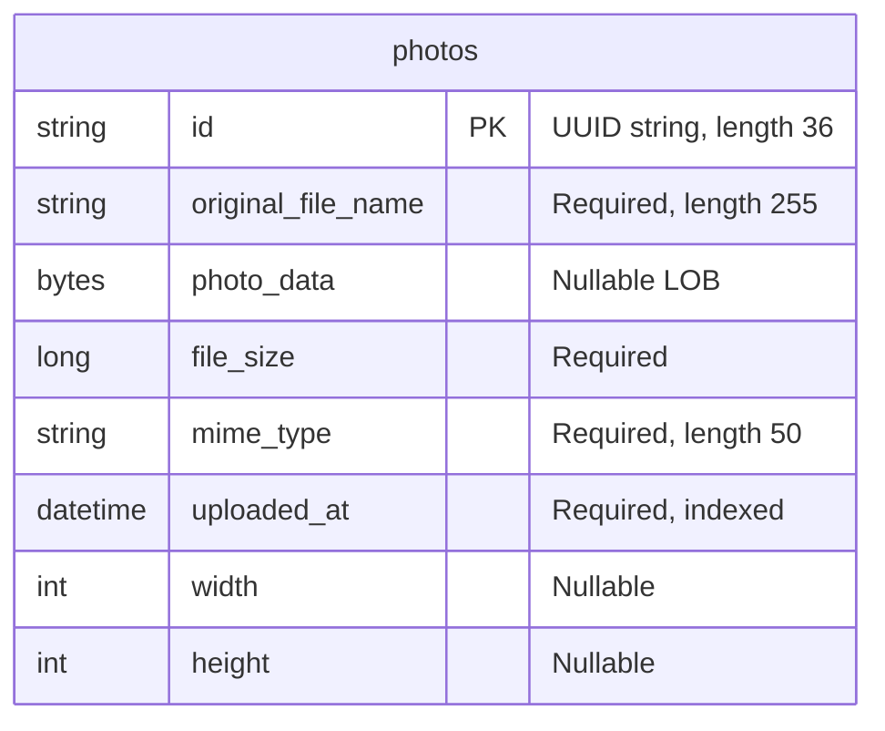

# Data Architecture & Persistence Layer

The persistence layer contains one JPA entity, `Photo`, accessed through Spring Data JPA/Hibernate. Oracle stores both photo metadata and image bytes; the test profile substitutes an in-memory H2 database. Sources: `pom.xml:43-54,88-93`, `src/main/java/com/photoalbum/model/Photo.java:15-76`.

## Database Configuration

| Service/Module | DB Type | Profile | Driver | Connection | Migration Tool |
|---|---|---|---|---|---|
| Photo Album | Oracle | Default/base | Oracle JDBC `ojdbc8`; `oracle.jdbc.OracleDriver` | JDBC Thin connection to localhost, port 1521, XE SID by default; environment-overridable connection and credentials | No Flyway/Liquibase declared; Hibernate recreates schema at startup |
| Photo Album | Oracle | `docker` | Oracle JDBC `ojdbc8`; `oracle.jdbc.OracleDriver` | JDBC Thin connection to `oracle-db`, port 1521, XE SID by default; environment-overridable connection and credentials | Hibernate recreates schema at startup |
| Photo Album tests | H2 | `test` | Test-scoped H2; `org.h2.Driver` | Named in-memory database `testdb` | Hibernate creates schema and drops it on shutdown |

Sources: `src/main/resources/application.properties:9-21`, `src/main/resources/application-docker.properties:1-17`, `src/test/resources/application-test.properties:1-10`, `pom.xml:43-54,88-93`. The context test explicitly activates `test` (`src/test/java/com/photoalbum/PhotoAlbumApplicationTests.java:7-12`).

- **Schema lifecycle:** Oracle startup schema recreation is destructive, not a versioned migration strategy. Entity annotations define the `photos` table and its upload-time index (`src/main/java/com/photoalbum/model/Photo.java:15-76`).
- **Initialization/seed data:** The Oracle initialization scripts provision the schema user and privileges, not photo rows; the SQL scripts verify the account and connectivity. No application schema migration or photo seed script was found in the inspected resources. Sources: `oracle-init/01-create-user.sh:19-47`, `oracle-init/create-user.sh:21-42`, `oracle-init/02-verify-user.sql:1-14`, `oracle-init/healthcheck.sql:1-3`.
- **Pooling:** No application-specific pool implementation, size, timeout, or tuning is declared in the three datasource property files. Pool runtime defaults are not verified here.
- For the complete property inventory, refer to the companion `configuration-inventory.md`; this report describes behavior rather than reproducing property assignments.

## Data Ownership per Service

| Service | Tables Owned | ORM Framework | Caching | Notes |
|---|---|---|---|---|
| Photo Album (`com.photoalbum`) | `photos` / `Photo` | Jakarta Persistence entity mapping, Spring Data JPA, Hibernate | No explicit application/entity/query cache configuration found | `PhotoServiceImpl` owns persistence operations through `PhotoRepository`; original image bytes are stored in the same row as metadata |

Sources: `src/main/java/com/photoalbum/model/Photo.java:15-76`, `src/main/java/com/photoalbum/repository/PhotoRepository.java:15-16`, `src/main/java/com/photoalbum/service/impl/PhotoServiceImpl.java:27-46,154-166,190-205`, `pom.xml:30-101`.

## Entity Model

The diagram uses database column names; the mappings below identify Java fields and types. There are no foreign keys, associations, relationship directions, cascade rules, or relationship fetch policies in the entity.

| Java field | Java type | Persistence mapping |
|---|---|---|
| `id` | `String` | Primary key, length 36; UUID assigned by constructor, not a database sequence |
| `originalFileName` | `String` | `original_file_name`, non-null, length 255 |
| `photoData` | `byte[]` | `photo_data`, nullable `@Lob`; no lazy basic-field annotation |
| `fileSize` | `Long` | `file_size`, non-null |
| `mimeType` | `String` | `mime_type`, non-null, length 50 |
| `uploadedAt` | `LocalDateTime` | `uploaded_at`, non-null; non-unique `idx_photos_uploaded_at`; constructor initializes local timestamp |
| `width` | `Integer` | `width`, nullable |
| `height` | `Integer` | `height`, nullable |

Entity source: `src/main/java/com/photoalbum/model/Photo.java:15-90`. No optimistic-lock version field is declared. `UploadResult` is an operation-result object, not a persisted entity (`src/main/java/com/photoalbum/model/UploadResult.java:3-10`).

**Transactions:** `PhotoServiceImpl` is class-level transactional. Listing, ID lookup, and older/newer-photo queries explicitly use read-only transactions; upload and deletion inherit the class-level setting. Sources: `src/main/java/com/photoalbum/service/impl/PhotoServiceImpl.java:27-29,52-70,80-81,190-202,215-229`.

## Key Repository Methods

All custom methods belong to `PhotoRepository extends JpaRepository<Photo, String>` in `src/main/java/com/photoalbum/repository/PhotoRepository.java:15-62`. Standard inherited CRUD methods are omitted below.

| Service | Repository | Notable Methods | Purpose |
|---|---|---|---|
| Photo Album | `PhotoRepository` | `List<Photo> findAllOrderByUploadedAtDesc()` | Native SQL returns all photos, including image bytes, newest first; Oracle `NVL` supplies a fallback MIME type |
| Photo Album | `PhotoRepository` | `List<Photo> findPhotosUploadedBefore(LocalDateTime uploadedAt)` | Native SQL selects strictly older photos, orders descending inside a subquery, and caps the result at ten rows with Oracle `ROWNUM` |
| Photo Album | `PhotoRepository` | `List<Photo> findPhotosUploadedAfter(LocalDateTime uploadedAt)` | Native SQL selects strictly newer photos no later than database `SYSDATE`, orders ascending, and has no explicit row limit; uses Oracle `DUAL` |

Method/query evidence: `src/main/java/com/photoalbum/repository/PhotoRepository.java:18-62`. The service takes only the first result for older/newer navigation (`src/main/java/com/photoalbum/service/impl/PhotoServiceImpl.java:215-229`). These queries return full entities rather than metadata-only projections, so listing and navigation select the LOB column too. No custom batch aggregation query, stored procedure call, or cross-service finder is present in this interface.

## Caching Strategy

| Layer | Observed strategy | Provider / TTL / eviction |
|---|---|---|
| Application/repository | No explicit Spring Cache annotations or cache provider configuration found in the inspected application sources and properties | No Redis, Caffeine, Ehcache, JCache binding, named regions, TTL, or eviction policy declared in `pom.xml:30-101` or the datasource configurations |
| Hibernate | No explicit second-level or query cache configuration found; normal persistence-context identity management is not a shared application cache | No configured cache provider or TTL identified |
| Image responses | Response construction explicitly disables client/intermediary storage and reuse | No-store/no-cache policy and immediate expiry; `src/main/java/com/photoalbum/controller/PhotoFileController.java:74-83` |
| Authentication/session | Administrator details are held in memory; session management is stateless, not a distributed session cache | `src/main/java/com/photoalbum/config/SecurityConfig.java:33-43,46-58` |

No cache-aside, read-through, write-through, or write-behind implementation was identified. A data-layer caching rationale is not documented in these sources; image response cache prevention is explicit.

## Data Ownership Boundaries

The inspected module has one application-owned relational table rather than separate service databases. Photo bytes and metadata share the same database record; the upload implementation reads bytes into memory and saves a `Photo`, and file serving reads those bytes from the retrieved entity. Sources: `src/main/java/com/photoalbum/model/Photo.java:15-76`, `src/main/java/com/photoalbum/service/impl/PhotoServiceImpl.java:111-118,154-166`, `src/main/java/com/photoalbum/controller/PhotoFileController.java:44-69`.

Reads and writes use the same repository/entity model. No separate read store, CQRS projection, cross-service database access, remote data aggregation, or outbox table is evidenced by the repository and service implementation (`src/main/java/com/photoalbum/repository/PhotoRepository.java:15-62`, `src/main/java/com/photoalbum/service/impl/PhotoServiceImpl.java:36-46,52-70,154-166,190-229`). No persisted user/tenant owner identifier or per-owner entity association exists in `Photo`; database initialization grants schema-level privileges, not row-level ownership (`src/main/java/com/photoalbum/model/Photo.java:19-76`, `oracle-init/01-create-user.sh:31-43`).

### Data Classification & Sensitivity

| Entity | Sensitive Fields | Classification (PII/PHI/PCI/None) | Controls in Place |
|---|---|---|---|
| `Photo` | `photoData`, `originalFileName` | Potential PII: uploaded images can depict identifiable people and filenames can contain personal information; contents are not classified by the model. No explicit PHI or PCI fields identified | No field encryption, masking, per-photo owner authorization, or encryption-at-rest configuration evidenced in inspected mappings/configuration. Photo reads are public; configured state-changing operations require authentication. Image responses disable caching |
| `Photo` | `id`, `fileSize`, `mimeType`, `uploadedAt`, `width`, `height` | None intrinsically; metadata can become identifying when linked to image content | Same record-level application controls; no field-specific access controls declared |

Sources: `src/main/java/com/photoalbum/model/Photo.java:19-90`, `src/main/java/com/photoalbum/config/SecurityConfig.java:46-58`, `src/main/java/com/photoalbum/controller/PhotoFileController.java:74-83`, `src/main/resources/application.properties:9-21`, `src/main/resources/application-docker.properties:1-17`. Infrastructure-managed encryption cannot be confirmed from these files. Password hashing protects the in-memory administrator credential, not stored photo content (`src/main/java/com/photoalbum/config/SecurityConfig.java:28-42`).

**Logging exposure:** The file-serving code logs original filenames and the first ten image bytes; upload logging also includes filenames. Sensitive data masking is not applied at these statements (`src/main/java/com/photoalbum/controller/PhotoFileController.java:53-72`, `src/main/java/com/photoalbum/service/impl/PhotoServiceImpl.java:168-175`).

**Source hyperlinks:** Paths below resolve from the final report's `reports/report-20261027020737/facts/` directory; inline citations above specify the relevant line ranges.

- [`pom.xml`](../../../../../../pom.xml)
- [`src/main/java/com/photoalbum/model/Photo.java`](../../../../../../src/main/java/com/photoalbum/model/Photo.java)
- [`src/main/java/com/photoalbum/model/UploadResult.java`](../../../../../../src/main/java/com/photoalbum/model/UploadResult.java)
- [`src/main/java/com/photoalbum/repository/PhotoRepository.java`](../../../../../../src/main/java/com/photoalbum/repository/PhotoRepository.java)
- [`src/main/java/com/photoalbum/service/impl/PhotoServiceImpl.java`](../../../../../../src/main/java/com/photoalbum/service/impl/PhotoServiceImpl.java)
- [`src/main/java/com/photoalbum/controller/PhotoFileController.java`](../../../../../../src/main/java/com/photoalbum/controller/PhotoFileController.java)
- [`src/main/java/com/photoalbum/config/SecurityConfig.java`](../../../../../../src/main/java/com/photoalbum/config/SecurityConfig.java)
- [`src/main/resources/application.properties`](../../../../../../src/main/resources/application.properties)
- [`src/main/resources/application-docker.properties`](../../../../../../src/main/resources/application-docker.properties)
- [`src/test/resources/application-test.properties`](../../../../../../src/test/resources/application-test.properties)
- [`src/test/java/com/photoalbum/PhotoAlbumApplicationTests.java`](../../../../../../src/test/java/com/photoalbum/PhotoAlbumApplicationTests.java)
- [`oracle-init/01-create-user.sh`](../../../../../../oracle-init/01-create-user.sh)
- [`oracle-init/create-user.sh`](../../../../../../oracle-init/create-user.sh)
- [`oracle-init/02-verify-user.sql`](../../../../../../oracle-init/02-verify-user.sql)
- [`oracle-init/healthcheck.sql`](../../../../../../oracle-init/healthcheck.sql)
