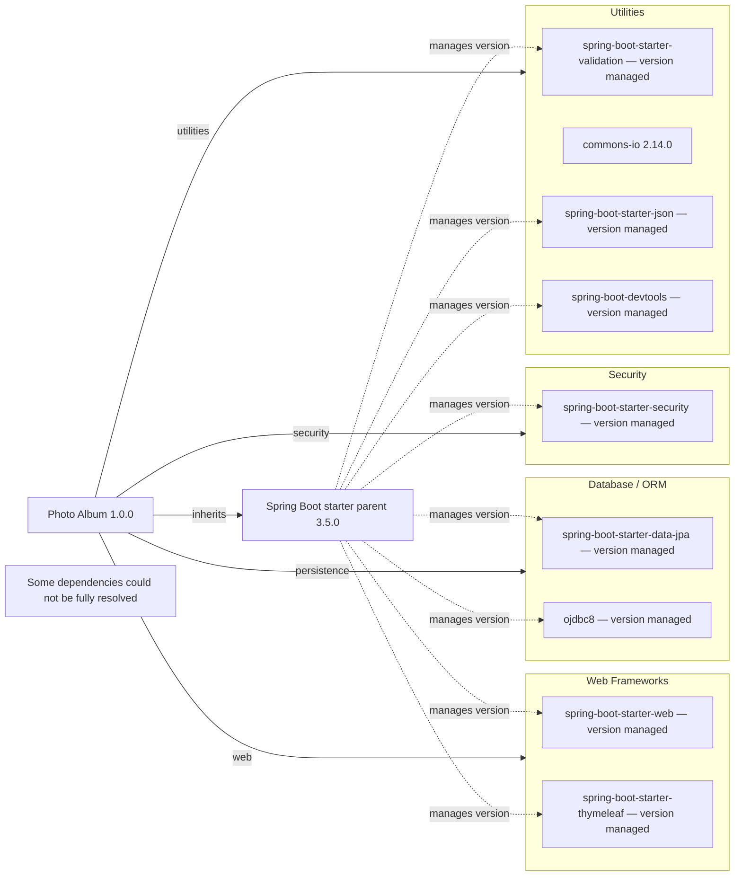

# Dependency Map

Photo Album (`com.photoalbum:photo-album:1.0.0`) declares **11 external dependencies: 9 non-test and 2 test-scoped**. This build-file-only inventory excludes the parent POM and build plugin from dependency counts; project identity is verified in [`pom.xml`, lines 15–21](../../../../../../pom.xml#L15-L21).

## Dependencies

“Version managed” means no version is declared locally and dependency management is inherited through `org.springframework.boot:spring-boot-starter-parent:3.5.0` ([parent declaration](../../../../../../pom.xml#L8-L13)). Exact effective versions and transitive trees were not resolved; the parent version is not asserted to be every managed artifact's version. No local BOM import or dependency-management overrides appear in the [POM](../../../../../../pom.xml#L1-L111), and no recognized dependency lockfiles were found.

### Dependency Summary

| Category | Count | Key Libraries | Notes |
|----------|------:|---------------|-------|
| Web Frameworks | 2 | `org.springframework.boot:spring-boot-starter-web`; `org.springframework.boot:spring-boot-starter-thymeleaf` | Versions inherited; both default compile scope. [Lines 31–41](../../../../../../pom.xml#L31-L41). |
| Database / ORM | 2 | `org.springframework.boot:spring-boot-starter-data-jpa`; `com.oracle.database.jdbc:ojdbc8` | Versions inherited; JPA default compile scope, Oracle runtime scope. [Lines 43–54](../../../../../../pom.xml#L43-L54). |
| Security | 1 | `org.springframework.boot:spring-boot-starter-security` | Version inherited; default compile scope. [Lines 62–66](../../../../../../pom.xml#L62-L66). |
| Utilities | 4 | `org.springframework.boot:spring-boot-starter-validation`; `commons-io:commons-io:2.14.0`; `org.springframework.boot:spring-boot-starter-json`; `org.springframework.boot:spring-boot-devtools` | Default compile scope throughout; only Commons IO has an explicit version. DevTools is optional. [Lines 56–60](../../../../../../pom.xml#L56-L60), [68–79](../../../../../../pom.xml#L68-L79), [95–100](../../../../../../pom.xml#L95-L100). |
| **Total non-test** | **9** | | Counts are direct declarations, not transitive packages. |

### Version & Compatibility Risks

The build targets Java 21 and inherits Spring Boot parent 3.5.0 ([lines 8–13](../../../../../../pom.xml#L8-L13), [23–28](../../../../../../pom.xml#L23-L28)); any upgrade must keep the Java runtime and managed framework versions compatible. Commons IO is explicitly pinned to 2.14.0, so its update lifecycle must be reviewed separately from inherited versions ([lines 68–73](../../../../../../pom.xml#L68-L73)). The exact Oracle JDBC version is unresolved, preventing a version-specific Java 21 compatibility conclusion. Current support status and security advisories were not checked; no end-of-life or vulnerability conclusion is made from the declarations alone.

### Notable Observations

- The parent is the only declared version-management entry point; no explicit BOM imports are present. The Spring Boot Maven plugin is also declared without a version, but is build tooling rather than an application dependency ([lines 103–110](../../../../../../pom.xml#L103-L110)).
- DevTools is optional but has no runtime or test scope declaration, so its Maven scope defaults to compile. Optional does not mean test-only ([lines 95–100](../../../../../../pom.xml#L95-L100)).
- The JSON starter is categorized as a utility despite the adjacent “Image processing” comment; the declared artifact is `spring-boot-starter-json`, not a dedicated image-processing library ([lines 75–79](../../../../../../pom.xml#L75-L79)).
- Logging, caching, messaging and observability libraries are not separately declared. Their absence from this direct-dependency diagram does not establish their absence from the resolved transitive tree.

## Test Dependencies

| Framework | Version | Notes |
|-----------|---------|-------|
| `org.springframework.boot:spring-boot-starter-test` | Inherited; exact version unresolved | Explicit test scope; testing starter. Its constituent frameworks are not individually declared and their versions were not resolved. [Lines 81–86](../../../../../../pom.xml#L81-L86). |
| `com.h2database:h2` | Inherited; exact version unresolved | Explicit test scope; database support for tests. [Lines 88–93](../../../../../../pom.xml#L88-L93). |

Total test-scope dependencies: 2

No separate contract-testing or container-based integration-testing library is explicitly declared. Build declarations alone do not establish which tests exist or whether database tests reproduce Oracle-specific behavior.
