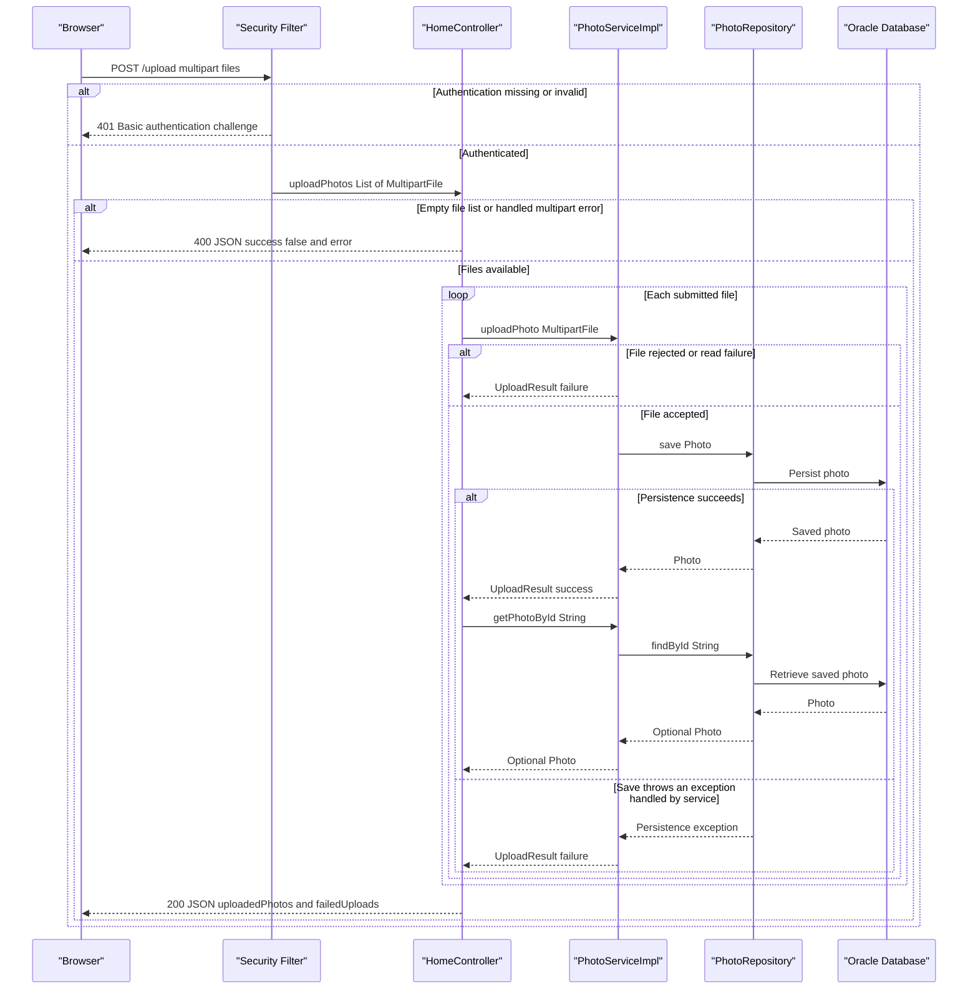

# API & Service Communication Contracts

The application exposes five controller-defined HTTP endpoints: two HTML views, a multipart upload returning JSON, a deletion action, and a binary photo response. Requests use synchronous controller-to-service calls and database access; no service-to-service HTTP API or messaging contract was found.

## Service Catalog

| Service | Port | Category | Purpose |
|---|---|---|---|
| `photoalbum-java-app` / Maven `com.photoalbum:photo-album` | 8080, also published as 8080 in Compose | API Layer / Business | Source-built application serving the gallery, photo uploads, detail navigation, deletion, and image bytes. |
| `oracle-db` | 1521; Compose also publishes 5500 | Infrastructure | Third-party Oracle Database Express 21.3 container providing persistence; not a source-built API service. |

`pom.xml` defines one executable JAR, not a multi-module build. Key application dependencies are Spring Boot Web, Thymeleaf, Data JPA, Security, Validation, JSON, and the Oracle JDBC driver. `docker-compose.yml` defines the two services above; no additional deployment services were identified.

Evidence: `pom.xml`, `Dockerfile`, `docker-compose.yml`, and the application resource files.

## API Endpoints Inventory

All paths are unversioned. There is no URL, header, or query-based API versioning scheme.

| Service / controller | Method | Path | Request Type | Response Type |
|---|---|---|---|---|
| Application / `HomeController` | GET | `/` | No required parameters | 200 HTML rendered from `index`, using `List<Photo>` in the view model. Retrieval errors produce an empty gallery rather than an explicit error status. |
| Application / `HomeController` | POST | `/upload` | `multipart/form-data`; repeated required `files` parts bound to `List<MultipartFile>`; HTTP Basic authentication | 200 JSON `Map<String,Object>` containing `success`, `uploadedPhotos`, and `failedUploads`. Empty input or controller-handled `MultipartException`: 400 JSON containing `success=false` and `error`. Missing authentication: 401. |
| Application / `DetailController` | GET | `/detail/{id}` | String path parameter `id` | 200 HTML rendered from `detail`, with a `Photo` and optional previous/next photo identifiers. Missing photo, invalid ID, or retrieval/navigation error: redirect to `/` (normally 302). |
| Application / `DetailController` | POST | `/detail/{id}/delete` | String path parameter `id`; no request body contract; HTTP Basic authentication | Redirect to `/` (normally 302) after successful deletion, missing photo, or deletion error; adds a success/error flash attribute. Missing authentication: 401. |
| Application / `PhotoFileController` | GET | `/photo/{id}` | String path parameter `id`; browser may append an ignored cache-busting `_t` query parameter | 200 `ResponseEntity<Resource>` backed by `ByteArrayResource`, using the stored media type. Missing photo or empty bytes: 404 with no body. Caught processing/retrieval error: 500 with no body. |

Upload item rejection is reported inside the 200 response, including when every submitted file fails; it is not uniformly a 400 response. Files are processed sequentially, and successful items are re-read to build response metadata. A missing required multipart parameter can also be rejected by Spring MVC before handler execution.

Binary photo responses set no-cache headers and `X-Photo-ID`, `X-Photo-Name`, and `X-Photo-Size`. Controllers do not define a common error DTO or global error-envelope policy.

Evidence: `src/main/java/com/photoalbum/controller/{HomeController,DetailController,PhotoFileController}.java`; `src/main/resources/static/js/upload.js`.

## Management & Observability Endpoints

| Service | Endpoint | Custom Metrics (if any) |
|---|---|---|
| Application | No dedicated health, Actuator, metrics, Prometheus, or Swagger endpoint defined | None found; application logging is present, but no custom metrics registrations or timing annotations were identified. |
| Oracle container | Port 5500 is published; no management HTTP path is defined in this repository | No application metrics contract identified. |

Spring Boot Actuator and OpenAPI UI dependencies are absent. The application root is a gallery endpoint, not a dedicated readiness/health contract. Container health configuration does not create an application management API.

## DTOs & Contracts

| Class / type | Contract role | Mutability |
|---|---|---|
| `Photo` | Service-owned domain entity used in HTML view models and as the source for selected upload-response metadata and binary image content; not returned directly as a JSON entity endpoint | Mutable POJO |
| `UploadResult` | Internal service outcome returned by `PhotoService.uploadPhoto`; translated by the controller into upload success/failure JSON entries | Mutable POJO |
| `MultipartFile` / `List<MultipartFile>` | Framework-provided multipart upload request binding | Framework abstraction; no immutable request record |
| `Map<String,Object>` and nested lists/maps | Ad hoc external JSON upload envelope and per-item results | Mutable collections; no dedicated response DTO class |
| `Resource` / `ByteArrayResource` | Binary photo response body abstraction | Not a domain DTO |

There are no gateway-level aggregation DTOs. Jackson supplied through Spring Boot JSON handles map serialization, including timestamps in upload metadata; no custom serializer or serialization override was identified. Thymeleaf renders view-model entities separately from the JSON upload contract.

No OpenAPI/Swagger specification, protobuf schema, GraphQL schema, or associated endpoint implementation was found. For entity fields and persistence mapping, see the companion `data-architecture.md`; individual validation rules belong in `business-workflows.md`.

## Communication Patterns

- **Browser to application:** HTML navigation and form deletion use HTTP; upload JavaScript uses same-origin `fetch('/upload')` with `FormData`. JavaScript's `async`/`await` is client-side request handling, not asynchronous inter-service messaging. No message broker, event bus, pub/sub, or gRPC usage was found.
- **Inside the application:** Controllers directly invoke `PhotoService`, implemented by `PhotoServiceImpl`, which calls `PhotoRepository`. Repository calls use Spring Data JPA and synchronous JDBC communication with Oracle. Detail rendering combines the selected photo and navigation identifiers within one application, not through gateway composition.
- **Resilience and timeouts:** No circuit breaker, automatic request retry, bulkhead, or application-defined outbound HTTP timeout was identified. No explicit JDBC connection/read timeout was identified in the reviewed application settings. Browser upload code defines neither an abort timeout nor a retry policy. Compose process restart behavior is not a request retry contract.
- **Fallback behavior:** Gallery retrieval errors return an empty HTML gallery; detail errors redirect home; deletion errors also redirect with an error flash attribute. Upload service failures usually become per-file failure entries; errors outside that handling have no custom fallback. Binary photo retrieval errors return 500. No cross-service aggregation fallback exists.
- **Discovery and routing:** Compose provides service-name resolution for database connectivity. No Eureka/Consul registration, API gateway, application client-side load balancing, or backend HTTP-service client was found.
- **Availability:** Compose orders application startup after database health. Database connectivity and required administrator configuration affect application availability; see `configuration-inventory.md` for startup/configuration details.
- **API security:** `SecurityConfig` requires authentication for POST `/upload` and `/detail/*/delete`, using stateless HTTP Basic and an in-memory administrator account. Read endpoints are public. The configured account has an administrator role, but endpoint rules check authentication rather than a specific role; no method-level authorization was found. CSRF protection is explicitly disabled. No application TLS listener or HTTPS termination service is configured in the inspected deployment, so secure transport must be supplied externally. No JWT or OAuth2 contract was found.

Evidence: `src/main/java/com/photoalbum/config/SecurityConfig.java`, `src/main/java/com/photoalbum/service/impl/PhotoServiceImpl.java`, `src/main/java/com/photoalbum/repository/PhotoRepository.java`, controller sources, upload JavaScript, and Compose. No credential values are reproduced here.

## Service Technology Matrix

Columns unused by every service (gateway, Actuator, cache, metrics export) are omitted.

| Service | Web | Data Access | Discovery |
|---|---|---|---|
| `photoalbum-java-app` | Spring MVC / Thymeleaf; JSON and binary responses | Spring Data JPA / Hibernate / Oracle JDBC | Compose DNS for database host; no discovery client |
| `oracle-db` | No application web API; management port published | Oracle database server | Compose service name |

No application caching layer was found. Photo responses explicitly discourage HTTP caching.

## Service Communication Sequence

Primary multipart-upload flow, including authentication failure and per-file rejection. Dashed arrows below represent responses, not broker events.

The diagram shows handled paths; transaction-completion failures or an exception during the post-save metadata lookup can escape the controller without this normal 200 envelope. There is no automatic retry or circuit-breaker fallback.
