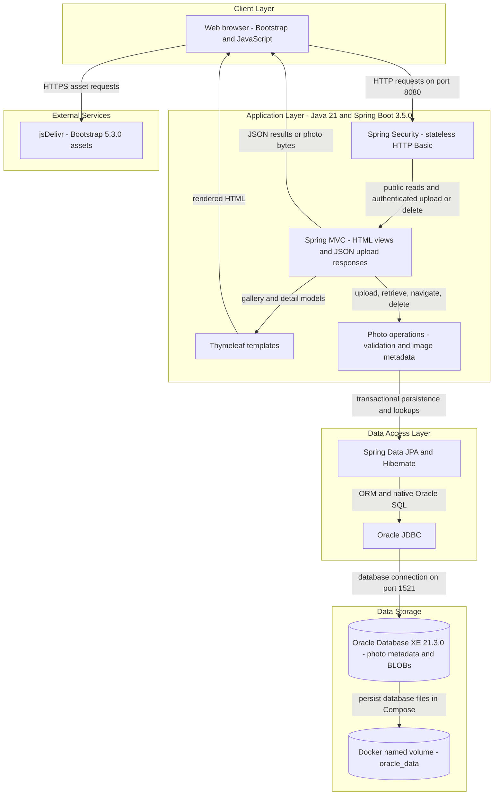
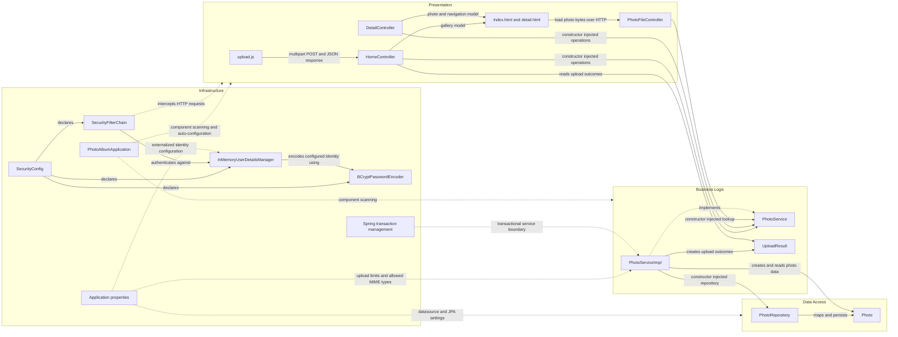

# Architecture Diagram

Photo Album is a single-module, server-rendered Spring Boot application for uploading, browsing, viewing, and deleting photos. This assessment reflects the source code, Maven build, application configuration, templates, and Docker Compose deployment.

## Application Architecture

### Technology Stack Summary

| Layer | Technology | Version | Purpose |
|---|---|---|---|
| Runtime | Java / Eclipse Temurin | 21 | Runs the executable application JAR; container runtime uses a JRE |
| Application | Spring Boot | 3.5.0 | Auto-configuration and embedded web application hosting |
| Presentation | Spring MVC and Thymeleaf | Managed by Spring Boot 3.5.0 | Gallery and detail HTML, multipart upload endpoint, photo byte responses |
| Browser | Bootstrap and JavaScript Fetch API | Bootstrap 5.3.0; browser-provided JavaScript | Responsive pages and asynchronous multipart uploads |
| Security | Spring Security and BCrypt | Managed by Spring Boot 3.5.0 | Stateless HTTP Basic authentication and in-memory administrative identity |
| Business logic | Spring services, transactions, Java ImageIO | Spring Boot managed; ImageIO from Java 21 | Photo operations, upload validation, image dimension extraction |
| Persistence | Spring Data JPA, Hibernate, Oracle JDBC driver `ojdbc8` | Managed by Spring Boot 3.5.0 | Entity mapping, CRUD, and native Oracle queries |
| Database | Oracle Database Express Edition | Compose image tag 21.3.0-xe | Stores photo metadata and binary content |
| Build and deployment | Maven, Docker multi-stage build, Docker Compose | Build image Maven 3.9.9; Docker and Compose versions not pinned | Builds the JAR and deploys application plus database |
| Test storage | H2 | Managed by Spring Boot 3.5.0 | Test-scoped database dependency, not production storage |

### Data Storage & External Services

Oracle stores photo bytes as a LOB and metadata in the `photos` table, including a UUID string identifier, original filename, MIME type, size, upload timestamp, and optional dimensions. Runtime uploads are stored in the database, not an upload directory or object store. Docker Compose persists database files through `oracle_data`; the application container has no photo-storage volume. Both default and Docker profiles configure Hibernate schema recreation with `ddl-auto=create`, so persistent database files do not imply preservation of application tables across application starts. Browser templates load Bootstrap CSS and JavaScript from jsDelivr. No application-level cache, message broker, email service, or external business API integration was identified.

### Key Architectural Decisions

- A layered monolith uses constructor injection: MVC controllers depend on the `PhotoService` interface, its implementation depends on `PhotoRepository`, and Spring manages transactions around service operations.
- Photo content and metadata share the Oracle persistence model. Repository queries use Oracle-specific native SQL features, including `NVL`, `ROWNUM`, `SYSDATE`, and `DUAL`.
- Gallery and photo reads are public; upload and delete POST requests require authentication. Security uses a configured in-memory identity with BCrypt, stateless HTTP Basic, and disabled CSRF; sensitive configuration values are externalized.

## Component Relationships

### Component Inventory

| Component | Layer | Type | Responsibility |
|---|---|---|---|
| `HomeController` | Presentation | Spring MVC controller | Serves `GET /`, processes `POST /upload`, assembles upload JSON, and handles multipart exceptions |
| `DetailController` | Presentation | Spring MVC controller | Serves `GET /detail/{id}`, builds previous and next navigation, and processes `POST /detail/{id}/delete` |
| `PhotoFileController` | Presentation | Spring MVC controller | Serves `GET /photo/{id}` as database-backed image bytes with MIME type and no-cache headers |
| `index.html`, `detail.html` | Presentation | Thymeleaf views | Render gallery cards, photo details, image links, navigation, and deletion form |
| `upload.js` | Presentation | Browser script | Submits multipart files with Fetch and updates the gallery using upload responses |
| `PhotoService` | Business logic | Service interface | Defines photo listing, lookup, upload, deletion, and chronological navigation operations |
| `PhotoServiceImpl` | Business logic | Transactional Spring service | Implements operations, validates MIME type and file size, extracts image dimensions with a pixel limit, and delegates persistence |
| `UploadResult` | Business logic | Result DTO | Carries per-file upload success, photo identifier, filename, and error information to the controller |
| `PhotoRepository` | Data access | Spring Data JPA repository | Provides standard CRUD and native Oracle queries for ordering and navigation |
| `Photo` | Data access | Jakarta Persistence entity | Maps photo binary content and validated metadata to the `photos` table |
| `PhotoAlbumApplication` | Infrastructure | Spring Boot entry point | Starts the application and enables auto-configuration and component discovery |
| `SecurityConfig` | Infrastructure | Spring configuration | Defines the security filter chain, in-memory identity manager, and password encoder |
| `SecurityFilterChain` | Infrastructure | Security bean | Applies stateless HTTP Basic, authentication requirements for upload and delete, public access otherwise, and disabled CSRF |
| `InMemoryUserDetailsManager` | Infrastructure | Identity store bean | Holds the configured administrative identity without a database-backed user model |
| `BCryptPasswordEncoder` | Infrastructure | Password encoder bean | Encodes the configured identity password |
| Application properties | Infrastructure | Default and Docker profile configuration | Supplies server port, datasource and JPA options, multipart limits, upload settings, and logging levels |
| Spring transaction management | Infrastructure | Framework cross-cutting concern | Applies service transactions and read-only semantics on lookup and navigation operations |
