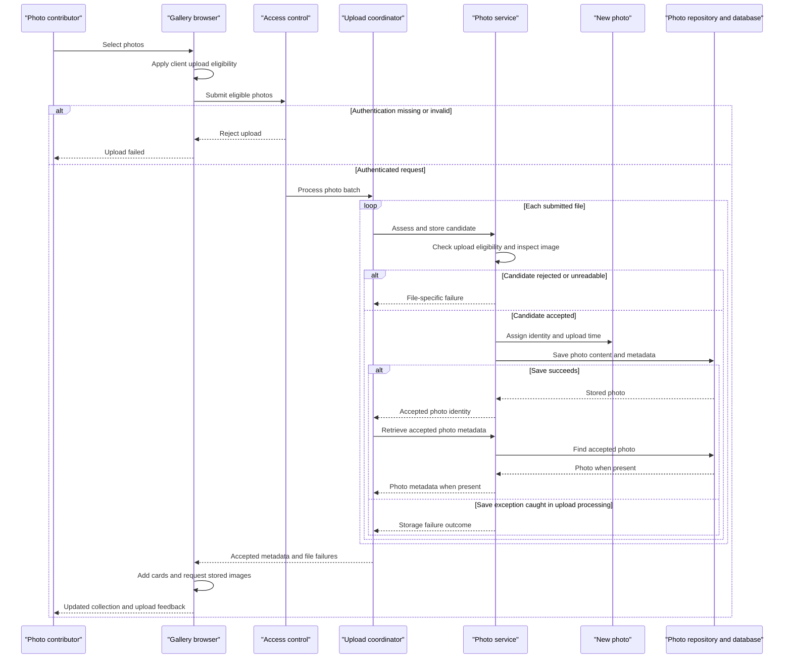

# Core Business Workflows

Photo Album lets visitors browse uploaded photographs, inspect individual images, and navigate chronologically through the collection. Authenticated users can add multiple photos and permanently remove photos from the shared gallery.

## Domain Entities

| Entity | Service / Bounded Context | Description | Key Relationships |
|---|---|---|---|
| Photo | PhotoService / Photo collection management | A photograph with its original content and descriptive information, available for gallery display and deletion. The sole persisted business entity; no explicit DDD aggregate framework is present. | Independent collection item; previous and next photos are derived from upload chronology, not stored relationships. No user ownership or album grouping is modeled. |
| UploadResult | PhotoService / Upload processing | Transient outcome of processing one candidate photo, not a persisted entity. Communicates acceptance or a reason for rejection. | Refers to the newly stored Photo on success; controller combines individual outcomes into batch feedback. |

Evidence: `src/main/java/com/photoalbum/model/Photo.java:19-90`, `src/main/java/com/photoalbum/model/UploadResult.java:6-10`.

## Service-to-Domain Mapping

This is one application with one business service, not a microservice deployment. The following are in-process responsibilities, not independently deployed services.

| Service | Domain Context | Owned Entities | External Dependencies |
|---|---|---|---|
| PhotoService, implemented by PhotoServiceImpl | Shared photo collection; upload acceptance, retrieval, chronology, and removal | Photo; transient UploadResult | PhotoRepository and the photo database; local image-header inspection |
| HomeController and browser upload client | Gallery presentation and batch upload orchestration | No separate persisted entities; consumes photos and upload outcomes | PhotoService; browser-to-application requests |
| DetailController | Individual photo inspection, adjacent-photo navigation, deletion feedback | No separate persisted entities | PhotoService |
| PhotoFileController | Delivery of stored photo content | No separate persisted entities | PhotoService |

PhotoService is the application-level source of truth for photo operations; all controllers use the same repository-backed collection. There are no cross-context identifiers, remote domain APIs, events, or shared-data joins between independently owned services.

Evidence: `src/main/java/com/photoalbum/service/PhotoService.java:13-54`, `src/main/java/com/photoalbum/service/impl/PhotoServiceImpl.java:29-47`, controller constructors.

## Primary Workflows

### Workflow 1: Upload multiple photos and update the gallery

1. A user selects or drops files into the gallery. The browser applies **Client upload eligibility** and submits eligible files together to `POST /upload`.
2. The security filter requires authentication before the controller processes this state-changing request.
3. HomeController applies **Batch presence**, then invokes PhotoService separately for each file.
4. PhotoService applies **Server upload eligibility** and **Image inspection**. An accepted candidate becomes a Photo with a generated identity and upload time; its content and metadata are saved together.
5. A rejected candidate yields an unsuccessful UploadResult with a file-specific error. The controller continues processing subsequent files when the service returns a failure result.
6. For each successful result, the controller reloads the Photo by its new identity and composes a metadata-only response item. If the reload returns no photo, that result is omitted from both response lists; a retrieval exception can instead interrupt the request.
7. The controller returns accepted-photo metadata and failed-file messages together under **Batch outcome**.
8. The browser prepends cards for accepted photos, requests their stored content separately, and displays returned per-file failures. An unsuccessful HTTP response or network error produces generic upload feedback.

This is synchronous controller orchestration, with independent per-file service transactions rather than an all-or-nothing batch. Previously committed files are not compensated if later processing fails.

Evidence: `src/main/resources/static/js/upload.js:60-132,135-179`, `src/main/java/com/photoalbum/controller/HomeController.java:56-107`, `src/main/java/com/photoalbum/service/impl/PhotoServiceImpl.java:80-184`.

### Workflow 2: Browse the collection and inspect adjacent photos

1. A visitor opens `GET /`. HomeController requests the collection and renders gallery cards under **Gallery ordering**.
2. If retrieval fails, the controller logs the error and renders an empty collection. The page uses the same “No photos yet” display as a genuinely empty collection; it does not distinguish an outage.
3. A visitor selects a photo through `GET /detail/{id}`. DetailController applies **Photo lookup** and retrieves the chosen photo.
4. The service derives previous and next photos using **Chronological navigation**. The detail page shows metadata and only those navigation links for which a neighbor exists.
5. The browser separately requests image content through `GET /photo/{id}`. PhotoFileController applies **Content availability** and returns the original stored bytes and media type. Images are delivered without reusable browser caching.
6. A missing photo or any detail-loading failure redirects to the gallery. Missing content returns not found; an unexpected content-serving exception returns a server error, without a substitute image.

Evidence: `src/main/java/com/photoalbum/controller/HomeController.java:38-50`, `src/main/java/com/photoalbum/controller/DetailController.java:32-59`, `src/main/java/com/photoalbum/controller/PhotoFileController.java:37-87`, `src/main/resources/templates/index.html:81-113`, `src/main/resources/templates/detail.html:62-132`.

### Workflow 3: Confirm deletion and return to the collection

1. On a photo detail page, the user selects Delete. The browser asks for confirmation; cancellation prevents submission but is not a server-side business constraint.
2. Confirmation submits `POST /detail/{id}/delete`; the security filter requires authentication.
3. PhotoService looks up the photo under **Deletion existence**, deletes it when present, and returns a boolean outcome.
4. DetailController redirects to the gallery with success or not-found feedback. A service exception instead produces retry-oriented failure feedback.
5. Removal is permanent in the application: there is no recycle bin, undo operation, or compensating recovery workflow.

Evidence: `src/main/resources/templates/detail.html:50-59`, `src/main/java/com/photoalbum/controller/DetailController.java:64-78`, `src/main/java/com/photoalbum/service/impl/PhotoServiceImpl.java:190-209`.

No scheduled business jobs, event listeners, batch commands, or business-state initialization routines were found in the application source. The application entry point only starts the application (`src/main/java/com/photoalbum/PhotoAlbumApplication.java:9-14`).

## Cross-Service Data Flows

There are no remote business-service calls or gateway aggregation endpoints. Composition happens inside the application:

- **Upload feedback:** browser files → HomeController → PhotoService → photo database. The controller uses each successful Photo identity to fetch metadata, combines accepted items and rejected-file messages, and returns them to the browser. Binary content is not included in that response.
- **Detail composition:** DetailController combines the chosen Photo with two chronology queries against the same collection. The browser joins that rendered metadata with a separate content request using the Photo identity.
- **Content delivery:** PhotoFileController obtains the Photo through the same business service and returns its stored content. The upload workflow does not write new photos to the static upload directory or a remote object service.
- **Degradation:** gallery retrieval failure becomes an empty-gallery display; detail retrieval or navigation failure redirects to the gallery; unavailable content produces not-found or server-error responses. Upload processing returns per-file errors where caught, but database failures during transaction completion or subsequent reload can escape that feedback path.

There is no circuit breaker, asynchronous propagation, remote-service fallback, or cached domain snapshot in these flows.

Evidence: `src/main/java/com/photoalbum/controller/HomeController.java:69-97`, `src/main/java/com/photoalbum/controller/DetailController.java:38-58`, `src/main/java/com/photoalbum/controller/PhotoFileController.java:44-86`, `src/main/java/com/photoalbum/service/impl/PhotoServiceImpl.java:154-177`.

## Business Workflow Sequence

The primary sequence shows batch upload, including per-file rejection and storage-error feedback. The fallback shown is local error handling, not a circuit breaker.

## Business Rules & Decision Logic

### Validation and acceptance

- **Client upload eligibility:** browser-declared media type must be JPEG, PNG, GIF, or WebP; each file must be at most 10 MiB. Other candidates are excluded locally. This is a convenience check, not authoritative server validation.
- **Batch presence:** an absent or empty file list is rejected as a bad request. HomeController maps multipart exceptions to the same “No files provided” response.
- **Server upload eligibility:** compare the lowercased declared content type against the configured allowlist, reject sizes above the configured maximum, and reject empty files. Current application settings allow the same four image types and 10 MiB per file; multipart parsing also limits the overall request to 50 MB. A missing content type reaches the generic unexpected-error handler.
- **Image inspection:** read image dimensions from the header where an image reader is available; reject an inspected image exceeding 40,000,000 pixels. File-reading IO errors fail the upload. No available reader or other dimension-extraction exceptions permit continuation without dimensions; this is not a requirement that every upload fully decode as an image.
- **Photo metadata validity:** the model declares a nonblank original filename of at most 255 characters, a nonblank media type of at most 50 characters, a positive nonnull file size, and a nonnull upload time. These are model validation constraints rather than controller-level validation of the multipart input.
- **Batch outcome:** response success is true only when at least one accepted photo has been reloaded into the response list. Normal processing returns HTTP success even when every file produces a rejection outcome. The configured maximum-files-per-upload value of 10 is not referenced by the controller or service and is not an implemented count limit.

Evidence: `src/main/resources/static/js/upload.js:65-79`, `src/main/java/com/photoalbum/controller/HomeController.java:63-107`, `src/main/java/com/photoalbum/service/impl/PhotoServiceImpl.java:33-34,80-152`, `src/main/java/com/photoalbum/model/Photo.java:31-64`, upload and multipart settings in `src/main/resources/application.properties`.

### Collection decisions and lifecycle

- **Gallery ordering:** collection retrieval sorts newest uploads first. There is no pagination or user-specific filtering in the business service.
- **Chronological navigation:** previous means the closest strictly older upload; next means the closest strictly newer upload no later than the database current time. The service takes the first ordered candidate. Equal upload timestamps are not neighbors, and future-dated photos are excluded from the newer-photo query.
- **Photo lookup:** blank or absent detail identities, nonexistent photos, and detail-loading errors return visitors to the gallery.
- **Content availability:** blank identities, missing photos, or absent/empty stored bytes produce not found. Unexpected retrieval or response-construction errors produce a server error.
- **Deletion existence:** missing photos produce a false outcome; existing photos are physically removed.
- **Lifecycle and integrity:** accepted photos enter the collection directly, with no draft, moderation, or publication state. Construction generates identity and upload time; rejected candidates are not saved. There is no duplicate-content/filename check, owner relationship, quota, or bidirectional domain relationship maintenance.
- **Computed presentation:** image dimensions are optional; gallery cards calculate rounded KiB sizes, while detail views choose bytes, KiB, or MiB according to magnitude. Displayed dates are derived from upload time.

Evidence: `src/main/java/com/photoalbum/repository/PhotoRepository.java:23-62`, `src/main/java/com/photoalbum/service/impl/PhotoServiceImpl.java:190-229`, `src/main/java/com/photoalbum/model/Photo.java:78-90`, detail and gallery templates.

### Cross-cutting business behavior

- **Transactions:** PhotoServiceImpl is transactional; retrieval and navigation methods are marked read-only. Each controller-to-service upload call has its own transaction, and the reload is a separate call. The whole batch and the multi-query detail view do not share a controller-level transaction. A caught save exception does not guarantee successful commit or guaranteed delivery of the returned UploadResult if the transaction is rollback-only.
- **Error handling:** upload failures use UploadResult rather than custom business exceptions. Retrieval/deletion errors are logged and wrapped as runtime exceptions; controllers translate them into the outcomes described above. No automatic retry, compensation, dead-letter flow, or saga is implemented.
- **Audit and logging:** successful uploads and deletions, rejected uploads, and retrieval failures are logged. Content serving additionally logs filenames, content sizes, and a short byte sample. There is no dedicated durable business audit entity or change-history workflow.
- **Authorization:** gallery, detail, and content reads are public. Upload and deletion require authentication through HTTP Basic; these routes do not explicitly require an administrator role or check resource ownership. The configured account is assigned an administrator role, but the collection itself is shared. Upload and delete controls remain visible on public pages, so their presence does not imply permission to mutate data.

Evidence: `src/main/java/com/photoalbum/service/impl/PhotoServiceImpl.java:27-28,53-74,164-184,190-229`, `src/main/java/com/photoalbum/config/SecurityConfig.java:33-59`, `src/main/java/com/photoalbum/controller/PhotoFileController.java:45-72`, upload and detail templates.
