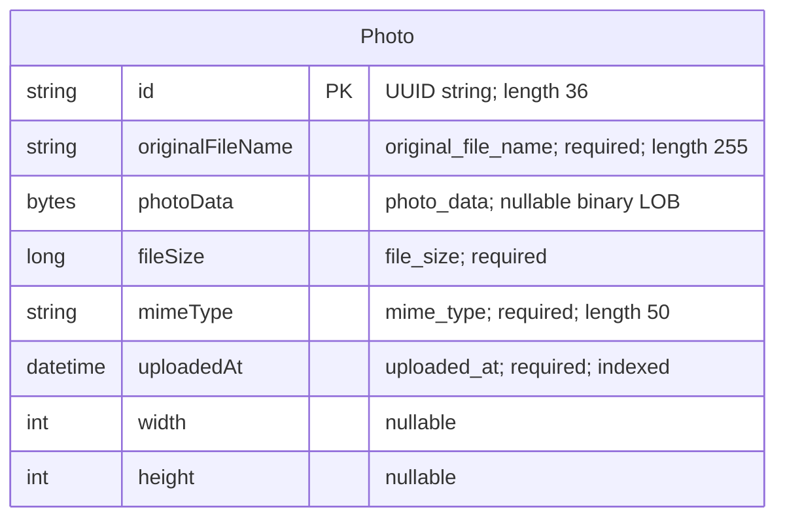

# Data Architecture & Persistence Layer

The data layer contains one persistent entity, `Photo`, accessed through Spring Data JPA and Hibernate. Oracle stores both photo metadata and binary image content; the test profile substitutes an in-memory H2 database.

## Database Configuration

| Service/Module | DB Type | Profile | Driver | Connection | Migration Tool |
|---|---|---|---|---|---|
| Photo album | Oracle | Default | `com.oracle.database.jdbc:ojdbc8`; `oracle.jdbc.OracleDriver` | Environment-overridable Oracle Thin JDBC connection; defaults to local Oracle XE | None detected; Hibernate recreates the mapped schema at startup |
| Photo album | Oracle | `docker` | Same Oracle JDBC dependency and driver | Environment-overridable Oracle Thin JDBC connection; defaults to the internal Oracle XE host | None detected; Hibernate recreates the mapped schema at startup |
| Photo album tests | H2 | `test` | Test-scoped `com.h2database:h2`; `org.h2.Driver` | In-memory JDBC database | None detected; Hibernate creates the schema and drops it on shutdown |

- Sources: `pom.xml:44-54,89-93`, `src/main/resources/application.properties`, `src/main/resources/application-docker.properties`, and `src/test/resources/application-test.properties`. The context test explicitly activates the test profile (`src/test/java/com/photoalbum/PhotoAlbumApplicationTests.java:7-8`).
- Default and Docker startup schema recreation is destructive rather than a versioned migration strategy. Oracle initialization scripts provision/verify the application schema account and permissions; they do not define or seed the `photos` table.
- No Flyway/Liquibase dependency, schema migration directory, SQL data seed, or programmatic database seeding was found. The bundled static image is not evidence of database seed data.
- No custom connection pool or pool sizing is declared. HikariCP is the expected Spring Data JPA auto-configured pool, not an explicitly configured implementation.
- Connection details are summarized without credentials. See `configuration-inventory.md` for the full property inventory.

## Data Ownership per Service

| Service | Tables Owned | ORM Framework | Caching | Notes |
|---|---|---|---|---|
| Photo album / `PhotoServiceImpl` | `photos` (`Photo`) | Spring Data JPA / Hibernate; Jakarta Persistence mappings | No explicit application or distributed cache | Binary content and metadata share the same row; one repository owns persistence access |

Evidence: `src/main/java/com/photoalbum/model/Photo.java:15-76`, `src/main/java/com/photoalbum/repository/PhotoRepository.java:15-16`, and `src/main/java/com/photoalbum/service/impl/PhotoServiceImpl.java:27-46`.

## Entity Model

`Photo` maps to `photos` in `src/main/java/com/photoalbum/model/Photo.java:15-76`:

| Java field | Java type | Persistence characteristics |
|---|---|---|
| `id` | `String` | Primary key, length 36; application-generated UUID in the constructor, not a database sequence |
| `originalFileName` | `String` | Non-null column, length 255 |
| `photoData` | `byte[]` | Nullable `@Lob`; image content stored in the database, not an external file reference |
| `fileSize` | `Long` | Non-null column |
| `mimeType` | `String` | Non-null column, length 50 |
| `uploadedAt` | `LocalDateTime` | Non-null column; initialized from the application clock; non-unique `idx_photos_uploaded_at` index |
| `width`, `height` | `Integer` | Nullable dimensions |

There are no foreign keys, entity associations, cascades, bidirectional mappings, or optimistic-lock version fields. Consequently, no relationship arrows are appropriate in the ER diagram. The LOB has no explicit lazy-fetch annotation; listing queries also explicitly select the binary column.

`UploadResult` is a nonpersistent result model, not another entity. `PhotoServiceImpl` establishes class-level transactions; retrieval and navigation methods override them as read-only (`src/main/java/com/photoalbum/service/impl/PhotoServiceImpl.java:27-28,53,67,216,226`). Upload and deletion use the class-level write transaction.

## Key Repository Methods

| Service | Repository | Notable Methods | Purpose |
|---|---|---|---|
| Photo album | `PhotoRepository` for `Photo`, keyed by `String` | `List<Photo> findAllOrderByUploadedAtDesc()` | Native SQL selects complete photo rows, including LOBs, newest first; Oracle `NVL` supplies a fallback MIME type |
| Photo album | `PhotoRepository` | `List<Photo> findPhotosUploadedBefore(LocalDateTime uploadedAt)` | Native SQL filters strictly older records, orders descending, and limits the outer result to ten rows using `ROWNUM` |
| Photo album | `PhotoRepository` | `List<Photo> findPhotosUploadedAfter(LocalDateTime uploadedAt)` | Native SQL filters strictly newer records up to Oracle `SYSDATE`, orders ascending, and uses `DUAL`; no explicit row limit |

Source: `src/main/java/com/photoalbum/repository/PhotoRepository.java:16-62`. All three custom methods are native `@Query` declarations; timestamp parameters use `@Param`. The interface extends `JpaRepository<Photo, String>` for standard inherited persistence operations; the service uses its inherited lookup, save, and delete operations.

No custom batch aggregation method, stored procedure call, derived finder, or named query was found. Navigation consumes only the first returned row, although the repository materializes lists. Oracle-specific native queries couple the persistence layer to Oracle; the H2 context-only test does not demonstrate their compatibility.

## Caching Strategy

| Layer | Provider / behavior | TTL / eviction / pattern |
|---|---|---|
| Application and distributed cache | No Spring Cache annotations, Redis, Caffeine, Ehcache, or JCache provider/configuration detected | No configured regions, TTL, eviction policy, or cache-aside/read-through/write-through pattern |
| ORM | Normal Hibernate persistence-context identity management; no second-level or query-result cache configuration detected | Persistence-context scoped, not a shared cross-request cache |
| Photo responses | Explicit response headers prohibit storage and require revalidation | `no-cache, no-store, must-revalidate, private`; this is client/proxy cache prevention, not a database cache |
| Session state | Stateless authentication; no session-cache integration detected | No session-cache TTL or provider |

Sources: `pom.xml`, application property files, `src/main/java/com/photoalbum/controller/PhotoFileController.java:77`, and `src/main/java/com/photoalbum/config/SecurityConfig.java:46-58`. No documented rationale for omitting server-side caching was found.

## Data Ownership Boundaries

One application persistence boundary owns one `photos` table. Oracle is the runtime store; H2 is a separate, ephemeral test substitute, not a replicated store or additional service-owned database. Photo bytes and metadata are colocated, with no mapped external object store or filesystem persistence relationship.

Controllers access photos through `PhotoService`, and `PhotoServiceImpl` accesses `PhotoRepository`. No other independently deployed data owner, cross-service direct database access, remote data aggregation, shared entity schema, outbox, or event-based synchronization was detected. Reads and writes use the same entity and repository; read-only transaction annotations do not constitute CQRS or a separate read model.

### Data Classification & Sensitivity

| Entity | Sensitive Fields | Classification (PII/PHI/PCI/None) | Controls in Place |
|---|---|---|---|
| `Photo` | `photoData` | Potential PII: user-supplied images may identify people or retain embedded metadata. PHI/PCI content is possible but not established by the model. | No application-level encryption, image metadata stripping, masking, or field-level/owner-level authorization detected. Reads are public; mutations require authentication. Photo response caching is disabled. Database encryption-at-rest is not established by repository configuration. |
| `Photo` | `originalFileName` | Potential PII if uploader-supplied names identify people | Same access controls; filenames are stored without a masking/encryption mapping and appear in service logs |
| `Photo` | `id`, `fileSize`, `mimeType`, `uploadedAt`, `width`, `height` | None intrinsically; operational metadata can become identifying when linked to image content | No separate field-level controls or encryption mappings detected |

The model has no dedicated person, health-record, payment-card, credential, or user-account table. Potential image/filename sensitivity is inferred from unrestricted content semantics, not from inspection of stored images. Authentication users are managed in memory rather than as JPA entities (`src/main/java/com/photoalbum/config/SecurityConfig.java:33-42`).

Security-control observations are based on source/configuration only; database-side encryption or external infrastructure controls cannot be confirmed from this assessment.
