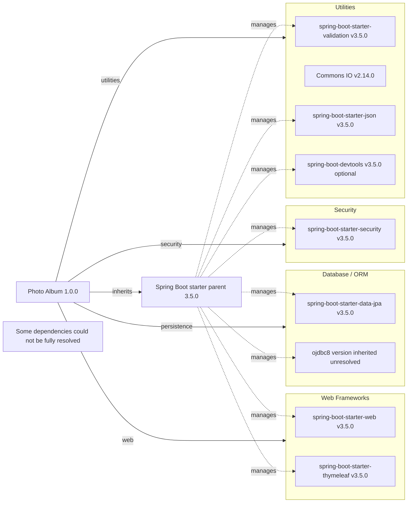

# Dependency Map

Photo Album (`com.photoalbum:photo-album:1.0.0`) declares 11 external dependencies in `pom.xml`: 9 non-test dependencies and 2 test dependencies. This map covers declared packages only; the Spring Boot parent is shown separately and is not included in dependency counts.

## Dependencies

### Dependency Summary

| Category | Count | Key Libraries | Notes |
|----------|-------|---------------|-------|
| Web Frameworks | 2 | `org.springframework.boot:spring-boot-starter-web`, `org.springframework.boot:spring-boot-starter-thymeleaf` — 3.5.0 inherited | Both default to compile scope. |
| Database / ORM | 2 | `org.springframework.boot:spring-boot-starter-data-jpa` — 3.5.0 inherited; `com.oracle.database.jdbc:ojdbc8` — inherited, unresolved | JPA defaults to compile scope; Oracle JDBC is explicitly runtime scope. |
| Security | 1 | `org.springframework.boot:spring-boot-starter-security` — 3.5.0 inherited | Defaults to compile scope. |
| Utilities | 4 | `org.springframework.boot:spring-boot-starter-validation`, `org.springframework.boot:spring-boot-starter-json`, `org.springframework.boot:spring-boot-devtools` — 3.5.0 inherited; `commons-io:commons-io` — 2.14.0 explicit | All default to compile scope; DevTools is optional. |
| **Total non-test** | **9** | | Parent POM and build plugin excluded. |

Version-management source: `org.springframework.boot:spring-boot-starter-parent:3.5.0` (`pom.xml:8–13`). There are no explicit BOM imports or dependency-management overrides in the workspace POM. Starter and DevTools versions follow the parent release; the parent/BOM contents are not present in the workspace, so exact Oracle JDBC and H2 versions and the resolved transitive dependency tree are not established here.

### Version & Compatibility Risks

Spring Boot 3.5.0 is an initial minor-release version; assess supported patch updates before modernization. Java 21 is the declared build target, and Spring Boot 3 uses Jakarta APIs, which matters when integrating older Java EE libraries. Commons IO 2.14.0 is explicitly pinned rather than following parent management and should be reviewed for current maintenance and security fixes. Oracle JDBC compatibility with Java 21 and the target database must be checked once its managed version is resolved. No vulnerability scan or end-of-life verification was performed.

### Notable Observations

- Spring Boot centrally manages all dependencies except the explicitly versioned Commons IO declaration; no lockfile was found among the recognized build/package files.
- The JSON starter is declared alongside the web starter. Potential transitive overlap is not counted twice here; no resolved dependency graph is available to confirm it.
- DevTools is optional but has default compile scope, not runtime or test scope. Optionality controls propagation to consumers; it does not make this a test dependency.
- The Spring Boot Maven plugin is declared without a version and inherits parent plugin management. Build plugins are separate from application dependencies and excluded from the diagram and totals.

## Test Dependencies

| Framework | Version | Notes |
|-----------|---------|-------|
| `org.springframework.boot:spring-boot-starter-test` | 3.5.0 inherited | Explicit test scope; testing-library bundle. Individual transitive framework versions are not visible in the workspace build file. |
| `com.h2database:h2` | Inherited, unresolved | Explicit test scope; in-memory database support. |

Total test-scope dependencies: 2

No separate integration-testing or contract-testing library is explicitly declared. H2 differs from the runtime Oracle database, so its presence alone does not establish Oracle-specific integration coverage; source code and tests were not inspected.
